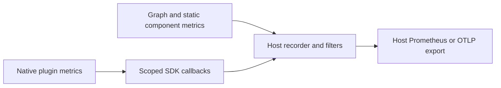

# Metrics for drasi-lib's Computation Graph

* Project Drasi - October 22, 2026 - Ruokun Niu (@ruokun-niu)
* Status: proposed replacement design; not implemented.
* Code baseline: drasi-core `8bb2a752`.

## Overview

This adapts the [original metrics design](https://github.com/drasi-project/design-documents/pull/7). The [overview](computation-graph-observability.md) defines shared ownership, profiles, and delivery slices; [tracing](computation-graph-tracing.md) defines context and spans. The catalogue, additional instruments, timing-token details, and limits remain proposals.

## Terms and definitions

<!-- These terms are internal to your design and will not be shared publicly. -->

| Term | Definition |
|------|------------|
| Recorder | The host-installed consumer of `metrics` registrations and updates. |
| Attempt | One execution of work, which may be retried without changing logical business identity. |
| Accepted / Handled | The sink's declared successful-call boundary; queue acceptance does not establish completed handling or external effects. |

## Objectives

<!-- Describes goals/non-goals and user-scenario of this feature to understand the end-user goals.

- If the feature shares the same objectives of the existing design, link the existing doc rather than repeat the same context.
- If the feature has a scenario, UX, or other product feature design doc, link it here and summarize the important parts. -->

### Goals

<!-- Describes goals to define why we need, where we go, and how we know whether we will be successful when we deliver this feature. -->

Report well-defined counts, durations, queue pressure, and health without depending on sampled traces or duplicating existing runtime ownership.


## Design requirements

### Requirements

<!-- List design goals or constraints that impact the design. Examples include extensibility points, maintainability, code reuse, considering if your feature needs to be taken down-level and coherency with related code. -->

1. Measure actual graph operations, including admission sources, sink batches, continuations, and scheduled work.
2. Distinguish attempts, envelopes, and result rows, and separate acceptance, processing, commit, forwarding, handling, and acknowledgement.
3. Include instance identity and count shared queues/multicast once per actual queue, not once per edge.
4. Record enabled counters and histograms independently of tracing; inspection watches are coalescing current-state views, not exact counters.
5. Use monotonic durations, preserve business/replay identities, and never invent continuous timing across restart.
6. Keep exporter I/O outside processing, install no recorder implicitly, and support both Tokio runtime flavors.

### Dependencies

Reuse pipe counters, query/reaction metrics, coherent inspection identities, and existing snapshot/profiling APIs. Add the `metrics` facade. The host supplies a compatible recorder and Prometheus/OTLP integration.

Native metrics use the computation contracts, computation ABI, plugin SDK, and Host SDK. The SDK must not depend on drasi-lib or the query engine. The bridge is shared with tracing, but metric collection does not require trace export.

### Out of scope

<!-- Describe the important issues or concerns NOT addressed by this proposal. 1 paragraph each (can be short). Often the "out of scope" items refer to the current state. We might already have planned work to address the "out of scope" items, mention it if that's the case. -->

Process measurements belong to the [server integration](../../drasi-server/computation-graph-observability-integration.md), not individual graph components. Engine-specific storage statistics and local telemetry queries remain follow-ups. End-to-end timing is a later slice, pending its completion contract.

## Design

### High-level design

<!-- Provide a high-level description, using diagrams as appropriate, and top-level explanations to convey the architectural/design overview. Don't go into a lot of details yet but provide enough information so that the relationship between these components and other components. Call out or highlight new components that are not part of this feature (dependencies). This diagram generally treats the components as black boxes. Provide a pointer to a more detailed design document, if one exists. If you have the alternatives for your design, describe alternative solution too. -->

Record at the authoritative operation rather than reconstructing counts from sampled spans or inspection watches. The graph supplies common measurements; components add internal details where needed. Existing atomic snapshots remain available alongside emitted metrics.

The main change from the previous design is moving common instrumentation from the fixed Source -> Query -> Reaction pipeline to graph execution and actual pipe implementations. The recorder/exporter architecture stays the same.

### Architecture Diagram

<!-- Provide an architecture design if applicable. An architecture diagram should be provided when the design involves multiple parts of Drasi (Communication between RPs, Communication between CLI and RPs, Protocol changes for UCP, Communication with external systems like clouds, etc.) -->



### Detail design

<!-- This section should be detailed and through enough that another developer could implement your design and provide enough detail to get a high confidence estimate of the cost to implement the feature but isn't as detailed as the code. Be sure to also consider testability in your design.

For each change, give each "change" in the proposal its own section and describe it in enough detail that someone else could implement it. Cover ALL of the important decisions like names. Your goal is to get agreement to proceed with coding and PRs.

If there are alternative you are considering please include that in the open questions section.

If the product has a layered architecture, it's good to align these sections with the product's layers. This will help readers use their current understanding to understand your ideas.

- **Advantages of this design** - Describe what's good about this plan relative to other options. Does it feel easy to implement? Provide flexibility for future work?
- **Disadvantages** - Describe what's not ideal about this plan. If you don't point these things out other people will do it for you. This is a good place to cover risks. -->

### 1. New Dependency: `metrics` Crate

Add the `metrics` facade using the version family proposed in the original design:

```toml
[dependencies]
metrics = "0.24"
```

The dependency belongs in [drasi-lib][lib-manifest] for graph instrumentation and in the [native computation SDK][sdk-manifest] for its scoped facade handles. Neither manifest declares it at the reviewed revision. These are proposed manifest changes, not implemented ones.

Recorder/exporter dependencies remain host-owned. Adding the facade to the native SDK does not introduce a dependency on drasi-lib or the query engine.

### 2. Collection Architecture

**drasi-lib emits measurements; the embedding application decides how to collect and export them.** Existing local snapshots remain available alongside the new facade emission.

| Responsibility | Owner |
|----------------|-------|
| Record common component and pipe operations | ComputationGraph and the relevant query/adapter implementation |
| Record optional component-internal measurements | The component, through its scoped SDK emitter |
| Install or supply the recorder, filters, and exporter | The embedding application |
| Forward native-plugin registrations and updates | The shared computation-ABI SDK/Host SDK bridge |
| Collect process-wide measurements | Drasi Server or another host |

Install collection before constructing components and caching their handles. The library does not replace an application's recorder or install one implicitly. When new collection is disabled, no-op handles leave existing logs, inspection, and local measurements intact.

Enabled metrics are recorded at their actual operation boundaries, independently of trace sampling. Exporter network I/O stays outside those operations. The build-mode-specific paths are described in [section 5](#5-metrics-by-build-mode).

### 3. Existing Metrics Inventory

The following inventory is based on drasi-core `8bb2a752`. These are existing local observation surfaces, not the proposed exported metric catalogue. In particular, the library's internal `metrics` module is separate from the external `metrics` facade crate.

#### 3.1 Query, reaction, and lifecycle snapshots

The existing [metrics inspection API][metrics-api] exposes snapshots of atomic measurements:

| API / backing type | Scope | Existing values |
|--------------------|-------|-----------------|
| `get_query_output_metrics(query_id)` / [QueryOutputMetrics][query-metrics] | Per query exposing this snapshot | Outbox size and sequence bounds, result-sequence advances, live-result count, last/max outer-transaction duration, snapshot-fetch count |
| `get_reaction_metrics(reaction_id)` / [ReactionMetrics][reaction-metrics] | Per ordinary reaction/query pair | Checkpoint sequence/lag, dedup skips, gap detection, recovery-policy triggers, snapshot/outbox fetch counts |
| `get_lifecycle_metrics()` / [LifecycleMetrics][lifecycle-metrics] | Ordinary reaction lifecycle within a Drasi instance | Startup rejections, completed auto-resets, and configuration-hash mismatches |

The native query implementation [updates the query measurements][query-observations]; ordinary reaction measurements remain tied to the corresponding adapter paths. These snapshots do not imply that every native sink exposes reaction recovery metrics or that service background activity is fully measured.

Keep these APIs and their current meanings. Last/max outer-transaction timings cannot reconstruct a histogram, and they are not the inner evaluator duration. The new histograms need observations at the measured operations.

#### 3.2 Pipe counters and graph inspection

Graph pipes can expose [PipeMetricsSnapshot][pipe-metrics] through their optional metrics capability:

| Snapshot fields | Existing meaning |
|-----------------|------------------|
| `accepted`, `delivered` | Provider acceptance and receive/dequeue counts, not completed sink handling |
| `discarded`, `blocked_sends` | Provider-observed discarded deliveries and blocked sends |
| `queued`, `max_queued` | Pending deliveries and their high-water mark |

These are non-transactional diagnostic snapshots; pending counts can briefly include a completing receive. A provider without this capability supplies no measurement, not a fabricated zero. The export path must identify the actual queue so shared bindings or multicast do not duplicate its series.

[Graph inspection][graph-inspection] supplies coherent component identities, status, and failures. Its watches coalesce publications, so use it for current-state observations, not as an exact counter of calls, events, or transitions.

#### 3.3 Profiling metadata and the Profiler Reaction

[ProfilingMetadata][profiling] retains optional source/query/reaction timestamps and elapsed-time helpers for the ordinary APIs. These timestamps use wall-clock time. They remain useful compatibility/diagnostic data, but they are not the source for the new monotonic operation-duration histograms or proof of uninterrupted timing across restart.

The optional [Profiler Reaction][profiler] aggregates available profiling intervals over its configured sample window and logs periodic statistical reports. Keep that tool unchanged; it is not the new recorder/exporter path.

This inventory does not commit to exporting every existing field. Section 4 selects the proposed instruments and adds common graph measurements where the existing snapshots do not provide them.

### 4. Proposed Metrics

#### Instrumentation by component

| Component | Common graph instrumentation | Component-specific detail |
|-----------|------------------------------|---------------------------|
| Source | Production/publication, output counts, forwarding, admission, failures, lifecycle | Upstream I/O and decoding |
| Transformer | Inputs, zero/one/many outputs, processing time, continuations, scheduled work, forwarding, failures | Internal transformation stages |
| Query | Same transformer instrumentation | Evaluation, commit, result changes, bootstrap, scheduled evaluation, replay |
| Sink | Handling and batch handling, duration, declared completion, failures | External requests, retries, and actual effects inside the handler |
| Service | Start/stop, readiness, failures, service execution | Background operations not visible to the graph |
| Pipe | Acceptance, dequeue, queue depth/peak, drops, blocking, acknowledgement where supported | Provider-specific durable/subscriber progress |


Ordinary Source/Reaction adapters remain supported. Their actual dispatch/processing boundaries supply measurements that a portless service wrapper cannot infer. Assign one owner to each measurement; a graph wrapper and adapter must not both increment the same instrument for the same operation.

#### Metrics and identities

All graph metrics include `instance_id` and `graph_id`. Component metrics additionally use `component_id` and `component_kind` (semantic category); execution role remains available in inspection/traces. Query-specific series retain `query_id`; reaction series retain `reaction_id` and `query_id`.

Queue series use stable `queue_id` within the graph. A physical shared queue is measured once, not once per edge. Per-subscriber progress uses `subscriber_id` only where the provider exposes it. Unsupported measurements are absent, not zero.

Do not turn generation, trace IDs, sequences, or error messages into metric labels. Counters accumulate for the process lifetime under a stable identity, including replacement generations. Gauges reset at the binding/replacement boundary; publish terminal zero for removed occupancy/up series and fence stale writers.

Exporter retention governs old series; capacity limits for continually changing configured IDs remain necessary. Do not add generation labels to evade retirement.

#### Counter accumulation across generations

Absolute counter updates report a total for the current binding/generation, not a process-wide or restored total that includes earlier generations. The scoped emitter converts these totals into increments of the stable host counter. Forwarding them directly to [`Counter::absolute`](https://docs.rs/metrics/0.24.2/metrics/trait.CounterFn.html#tymethod.absolute) would only raise the host counter to the reported value, losing contributions after replacement.

Each scoped counter tracks a local total `L`, initially zero, keyed by binding, generation, and instrument identity (name and labels). Re-registering the same instrument or cloning its handle shares this state:

| Scoped update | Local accounting | Host recorder update |
|---------------|------------------|----------------------|
| `increment(d)` | Set `L = L + d` | `Counter::increment(d)` |
| `absolute(v)` | Compute `delta = max(v - L, 0)`, then set `L = max(L, v)` | `Counter::increment(delta)` when positive |

Repeated or older absolute reports add nothing; a smaller value is not interpreted as a reset. Mixed calls refer to the same local count: an absolute report must include increments already reported for that count. Independent producers must not submit unrelated absolute totals under the same scoped instrument.

Apply this rule in static scoped handles and native Host SDK callbacks, exactly once per update. Serialize scope validation, local accounting, and forwarding per scoped counter so concurrent calls or revocation cannot double-count or admit stale writers. Replacement starts a new local total at zero without resetting the host series; revoked-generation updates are rejected through the existing loss diagnostics.

Required behavior in both build modes, starting with an empty host counter:

| Generation | Update | Forwarded increment | Host total |
|------------|--------|---------------------|------------|
| A | `absolute(100)` | 100 | 100 |
| B, replacing A | `absolute(10)` | 10 | 110 |
| B | `absolute(10)` again, then older `absolute(8)` | 0 | 110 |
| B | `increment(5)` | 5 | 115 |
| B | `absolute(15)` | 0 | 115 |
| B | `absolute(20)` | 5 | 120 |
| A, revoked | `absolute(120)` | Rejected | 120 |

#### Catalogue and count semantics

The proposed initial catalogue preserves the original operational metrics, adds four generic component instruments, and delays end-to-end timing until its completion contract is implemented:

| Metric | Type | Meaning / additional labels |
|--------|------|-----------------------------|
| `drasi.component.up` | Gauge | 1 after successful start and required readiness, until stopped, exhausted, failed, or quiesced. Ordinary idle/backpressure does not make it 0. |
| `drasi.component.calls` | Counter | Operation attempts, including failed/cancelled attempts; closed `operation` label |
| `drasi.component.inputs_processed` | Counter | Inputs successfully processed at the local boundary; `completion=accepted/handled/transformed` |
| `drasi.component.outputs_emitted` | Counter | Validated output envelopes produced per attempt, before fan-out; not number of subscribers |
| `drasi.component.operation.duration` | Histogram | Call elapsed time; `operation`, `outcome`; source waiting is identifiable |
| `drasi.source.events_dispatched` | Counter | Envelope publication attempts accepted by all bound destinations, once per envelope; `source_id`, `phase` |
| `drasi.query.events_processed` | Counter | Inputs whose query processing completed; `query_id`, `phase`; no increment for output-only replay or dedup skips |
| `drasi.query.results_emitted` | Counter | New result-row changes published locally; `query_id`, `change_kind=add/update/delete`; replay is not new output |
| `drasi.reaction.results_processed` | Counter | Results completed by the actual ordinary reaction processor, not enqueue; `reaction_id`, `query_id` |
| `drasi.queue.depth`, `drasi.queue.depth_max` | Gauges | Current pending deliveries and peak for the current binding; `queue_id` |
| `drasi.queue.blocked_enqueues`, `drasi.queue.drops` | Counters | Provider-observed blocking/drop events; `queue_id` |
| `drasi.reaction.checkpoint_lag_events` | Gauge | Known ordinary reaction/query checkpoint lag; never fabricated for an opaque sink |
| `drasi.errors` | Counter | One failed operation at its owning boundary; closed `error_kind` |
| `drasi.query.engine.duration` | Histogram | Inner evaluator elapsed time, excluding outer hook/commit; `query_id`, `phase` |
| `drasi.pipeline.end_to_end.duration` | Histogram, later slice | One valid source-to-handled-sink branch observation; `query_id`, `phase`; not "all branches finished" |

Generic and query/reaction metrics are different views, not additive totals. One envelope can contain multiple changes. Counts must specify envelopes, calls, or rows; a blanket "every counter equals N" test is incorrect.

Generic counts measure attempts, not globally deduplicated business events. Replaying output can increment transport/output-attempt counters without rerunning evaluation. Forwarding failure after partial acceptance remains a failure, not proof that nothing was delivered. Record errors once at the operation owner, not again every time the cause is reported.

`phase` remains `bootstrap` or `steady`; scheduled/replay distinctions are trace fields and operation categories.

The advantage is common instrumentation for new component implementations. The cost is defining count/completion semantics for arbitrary topology, batches, and replay rather than treating the catalogue as additive totals.

### 5. Metrics by Build Mode

#### 5.1 Statically Linked Build

Graph instrumentation, built-in components, and statically linked plugins use the host's normal `metrics` infrastructure:

```text
Graph / component -> scoped metrics facade handles -> host recorder -> host exporter
```

No FFI telemetry transport is needed. Register/cache handles after recorder installation and outside hot loops. The scoped SDK emitter attaches component identity at registration and applies the [counter accumulation rule](#counter-accumulation-across-generations) before updating the host recorder. Scoped counters wrap the host handle rather than expose it directly; an unscoped macro does not infer component identity or replacement semantics.

#### 5.2 Dynamically Loaded Build

A native plugin uses metric callbacks in the [shared computation-ABI telemetry extension](computation-graph-tracing.md#tracing-a-dynamically-loaded-build):

```text
Plugin handle -> SDK bridge -> scoped Host SDK callback -> host recorder -> host exporter
```

This is not the legacy Source/Reaction ABI or a second per-signal bridge. Register the instrument once; later updates carry its handle, operation, and value:

| Direction | Data | Handling |
|-----------|------|----------|
| Plugin -> host metric registration | Name, instrument type, labels, description, unit | Register/cache a scoped opaque handle outside hot loops; not a live Rust recorder handle. |
| Plugin -> host metric update | Registered handle, operation and value | Convert scoped counter increments/absolute totals to host increments using the shared accumulation rule; apply gauge set/increment/decrement or histogram observations directly. |

The SDK installs its library-local recorder once, but binds separate host-owned scopes for component instances. Host-assigned scope identity cannot be overridden by plugin labels; out-of-scope emissions are explicitly unattributed, not assigned to a random instance.

Records use bounded MessagePack and existing ABI buffer ownership rules. The host copies borrowed data before returning; callbacks cannot retain borrowed pointers. Handles are revocable and generation-fenced. Missing extensions retain host-side instrumentation and explicitly lack plugin internals; they do not fall back to the legacy ABI.

Metric updates are unsampled and applied locally before any lossy exporter queue. Do not route them through the [bounded, droppable completed-span queue](computation-graph-tracing.md#completed-span-buffering-and-loss). The embedder must use recorder implementations suitable for the hot path, with no network I/O in update callbacks.

Plugin authors optionally add internal metrics. The SDK provides scoped metric handles under `drasi.plugin.<kind>.*`; raw unscoped macros do not magically acquire component identity. Framework measurements remain host-owned so plugin telemetry does not duplicate them.

Keep callback owners alive through producer shutdown. Revoke scopes after producers stop and fence late updates before releasing owners; the [server design](../../drasi-server/computation-graph-observability-integration.md#6-shutdown) owns exporter shutdown.

### 6. Profiles, Filtering, and Cost Controls

Use the [shared profiles](computation-graph-observability.md#2-proposed-shared-profiles). Resolve metric exclusions and collection flags together; additional exclusions are substrings, not globs. Filtering cannot enable unimplemented collection. The persistence profile exposes supported observations, not every engine statistic.

Disabling new metrics must not disable ordinary logs or inspection. Metric enablement is independent of trace export and sampling.

### API Design

<!-- Include if applicable -- any design that changes our public REST API, CLI arguments/commands, or Go APIs for shared components should provide this section. Write N/A here if not applicable.

- Describe the REST APIs in detail for new resource types or updates to existing resource types. E.g. API Path and Sample request and response.
- Describe new commands in the CLI or changes to existing CLI commands.
- Describe the new or modified Go APIs for any shared components. -->

These are proposed responsibilities, not claims that the APIs already exist:

| Surface | Contract |
|---------|----------|
| `TelemetryProfile::resolve()` | Produces filters and collection flags; no exporter construction. |
| `DrasiLibBuilder::with_telemetry(...)` | Receives collection settings without installing a recorder; direct graph builders need equivalent settings. |
| Host SDK telemetry binding | Installs scoped metric registration/update callbacks before plugin construction, alongside the trace/log callbacks. |
| Scoped metric emitter | Registers custom instruments under the plugin's namespace, captures host-assigned identity, and applies the same counter accumulation semantics in static and native builds. |
| Host recorder setup | Install before components cache handles; retain exporter ownership through shutdown. |

Default construction leaves new collection off and preserves logs/inspection. No library REST, CLI, or Go API is added; scrape routes and server configuration belong to the companion server design.

#### SDK registration and submission

Register an instrument once, then update its cached handle. The SDK hides the difference between static and dynamic builds:

- **Static:** register against the host's normal `metrics` recorder with the component's identity labels. Scoped counter handles apply local accounting before incrementing the host counter; gauge and histogram updates use the host handles directly.
- **Native plugin:** register through the scope-bound Host SDK callback and receive an opaque handle. SDK-backed `metrics` handles turn later calls into typed updates for that handle; the Host SDK applies counter accounting, so the plugin does not also convert absolute totals.

The following Rust data shapes illustrate the proposed native registration/update contract. Names and wire details are not finalized:

```rust
use serde::{Deserialize, Serialize};

#[derive(Clone, Copy, Debug, Serialize, Deserialize)]
pub struct MetricHandleV1(pub u64);

#[derive(Clone, Copy, Debug, Serialize, Deserialize)]
pub enum MetricKindV1 {
    Counter,
    Gauge,
    Histogram,
}

#[derive(Debug, Serialize, Deserialize)]
pub struct MetricRegistrationV1 {
    pub name: String,
    pub kind: MetricKindV1,
    pub unit: String,
    pub description: String,
    pub labels: Vec<(String, String)>,
}

#[derive(Debug, Serialize, Deserialize)]
pub enum MetricUpdateV1 {
    CounterIncrement { handle: MetricHandleV1, value: u64 },
    CounterAbsolute { handle: MetricHandleV1, value: u64 },
    GaugeSet { handle: MetricHandleV1, value: f64 },
    GaugeIncrement { handle: MetricHandleV1, value: f64 },
    GaugeDecrement { handle: MetricHandleV1, value: f64 },
    HistogramRecord { handle: MetricHandleV1, value: f64 },
}
```

The binding supplies `instance_id`, `graph_id`, `component_id`, `component_kind`, and `plugin_kind` where applicable. Registration labels are additional bounded labels, not a way to override those identities. The handle belongs to that binding and generation; it is not a Rust recorder pointer.

For example, inside the SDK, the enabled counter path would look like this. `binding` and `diagnostics` represent proposed SDK interfaces:

```rust
let handle = binding.register_metric(MetricRegistrationV1 {
    name: format!("drasi.plugin.{}.frames_received", binding.plugin_kind()),
    kind: MetricKindV1::Counter,
    unit: "1".to_owned(),
    description: "Upstream frames received".to_owned(),
    labels: Vec::new(),
})?;

// Later: the cached counter's increment method submits only the handle and value.
let update = MetricUpdateV1::CounterIncrement { handle, value: 1 };
if let Err(error) = binding.update_metric(update) {
    diagnostics.report_metric_loss(error);
}
```

The native binding encodes bounded MessagePack records through the shared, versioned computation-ABI extension. The Rust structs and their `String`/`Vec` storage do not cross FFI by memory layout. This does not append fields to the legacy Source/Reaction registration table.

The host validates the scope, generation, instrument type, and value, then applies the [counter accumulation rule](#counter-accumulation-across-generations) before updating its cached handle. Both `CounterIncrement` and `CounterAbsolute` contribute through `Counter::increment`; generation-local totals never go directly to the host's `Counter::absolute`. Gauge and histogram updates use the corresponding operations, such as `Gauge::set` or `Histogram::record`. This happens locally, before exporter buffering. It is neither sampled nor sent through the span queue, and it performs no exporter network I/O.

`report_metric_loss` uses local, non-recursive loss diagnostics and rate-limited warnings, not the failing metric bridge. Update failure must not become a component-processing failure. Invalid registrations are reported during initialization; intentional collection disablement returns no-op facade handles before this enabled path. Missing bridge capabilities remain explicit diagnostics, not a claim that plugin metrics are working.

#### Component-defined custom metrics

The component uses a proposed `ScopedMetricEmitter` supplied by its runtime/SDK context. It provides only leaf names; the emitter adds the plugin namespace, host-assigned labels, and units. `MetricRegistrationError` represents an explicit registration/configuration failure.

For a JSON-framed change-feed source, optional metrics can be registered once and stored on the component:

```rust
use metrics::{Counter, Histogram, Unit};
use std::time::Instant;

pub struct ChangeFeedMetrics {
    frames_received: Counter,
    decode_duration: Histogram,
}

impl ChangeFeedMetrics {
    pub fn register(
        emitter: &ScopedMetricEmitter,
    ) -> Result<Self, MetricRegistrationError> {
        Ok(Self {
            frames_received: emitter.counter(
                "frames_received",
                Unit::Count,
                "Upstream frames received",
            )?,
            decode_duration: emitter.histogram(
                "decode.duration",
                Unit::Seconds,
                "Time spent decoding an upstream frame",
            )?,
        })
    }

    pub fn decode_frame(
        &self,
        frame: &[u8],
    ) -> Result<serde_json::Value, serde_json::Error> {
        self.frames_received.increment(1);
        let started = Instant::now();
        let decoded = serde_json::from_slice(frame);
        self.decode_duration.record(started.elapsed().as_secs_f64());
        decoded
    }
}
```

For plugin kind `changefeed`, these become `drasi.plugin.changefeed.frames_received` and `drasi.plugin.changefeed.decode.duration`. The duration observation is in seconds and includes failed decode attempts; the original decode result/error is returned unchanged. No frame contents are recorded.

The source calls `register` during initialization, after host recorder/binding setup, and reuses the handles for each frame. This example adds internal frame/decode measurements, not another increment of the graph's publication or processing counters.

The component writes no identity labels, installs no recorder or exporter, and has no static-versus-native branch. Handles retain their explicit component scope even when cloned into a worker. Neither updates nor timing are gated on whether a trace span was sampled.

### Alternatives Considered

<!-- Describe the alternative designs that were considered or should be considered. Give a justification for why alternative approaches should be rejected if possible. -->

- **Use inspection watches as counters:** coalesced publications can miss transitions; record at the authoritative operation instead.
- **Derive metrics from sampled traces:** cannot provide the required unsampled counts and histograms.
- **Have each plugin own exporters:** duplicates configuration and bypasses host controls.

## Security

<!-- Optional. Use this section to describe the security threats and its mitigations with this design---such as authenticating request, storing secrets and credentials, etc. -->

Framework labels are bounded identifiers and closed categories, not payloads, query text, SQL parameters, credentials, full endpoint URLs, or error messages. Bound series cardinality and validate native record schema, sizes, names, types, and host scope.

Reject reserved metric-namespace spoofing and identity-label overrides. Export transport authentication and access control belong to the host.


## Appendices

<!-- Optional. Describe additional information supporting this design. For instance, describe the details of alternative design if you have one. -->

The old five-stage latency model is replaced by explicit component and pipe boundaries. Existing wall-clock profiling fields are not used to manufacture continuous elapsed time across recovery.

## References

<!-- Optional. Add the design documents and references you use for this document. -->

- [Shared overview](computation-graph-observability.md) and [tracing design](computation-graph-tracing.md)
- [Server integration design](../../drasi-server/computation-graph-observability-integration.md)
- [Original metrics design](02-metrics.md) and [observability proposal][proposal]
- [Graph execution at the reviewed revision][execution]
- [Existing metrics inspection API][metrics-api] and [pipe measurements][pipe-metrics]
- [Profiling metadata][profiling] and [Profiler Reaction][profiler]
- [Library architecture rules][lib-rules] and [component/plugin rules][component-rules]

[proposal]: https://github.com/drasi-project/design-documents/pull/7
[execution]: https://github.com/drasi-project/drasi-core/blob/8bb2a752/lib/src/computation/v1/graph.rs
[lib-manifest]: https://github.com/drasi-project/drasi-core/blob/8bb2a752/lib/Cargo.toml
[sdk-manifest]: https://github.com/drasi-project/drasi-core/blob/8bb2a752/components/computation-plugin-sdk/Cargo.toml
[metrics-api]: https://github.com/drasi-project/drasi-core/blob/8bb2a752/lib/src/lib_core_ops/metrics_ops.rs
[query-metrics]: https://github.com/drasi-project/drasi-core/blob/8bb2a752/lib/src/metrics/query_metrics.rs
[query-observations]: https://github.com/drasi-project/drasi-core/blob/8bb2a752/lib/src/computation/v1/query.rs#L1158
[reaction-metrics]: https://github.com/drasi-project/drasi-core/blob/8bb2a752/lib/src/metrics/reaction_metrics.rs
[lifecycle-metrics]: https://github.com/drasi-project/drasi-core/blob/8bb2a752/lib/src/metrics/lifecycle_metrics.rs
[pipe-metrics]: https://github.com/drasi-project/drasi-core/blob/8bb2a752/lib/src/computation/v1/pipe_metrics.rs
[graph-inspection]: https://github.com/drasi-project/drasi-core/blob/8bb2a752/lib/src/computation/v1/inspection.rs
[profiling]: https://github.com/drasi-project/drasi-core/blob/8bb2a752/core-types/src/profiling.rs
[profiler]: https://github.com/drasi-project/drasi-core/blob/8bb2a752/components/reactions/profiler/src/profiler.rs
[lib-rules]: https://github.com/drasi-project/drasi-core/blob/8bb2a752/lib/AGENTS.md
[component-rules]: https://github.com/drasi-project/drasi-core/blob/8bb2a752/components/AGENTS.md
