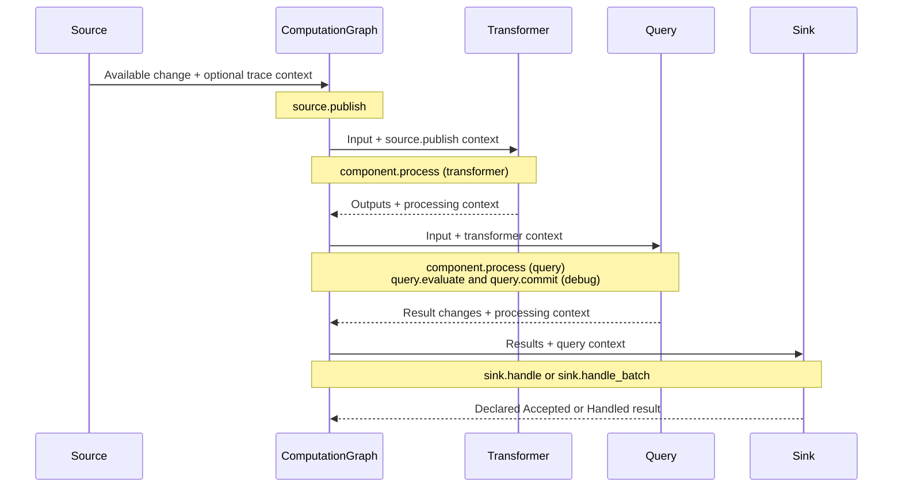
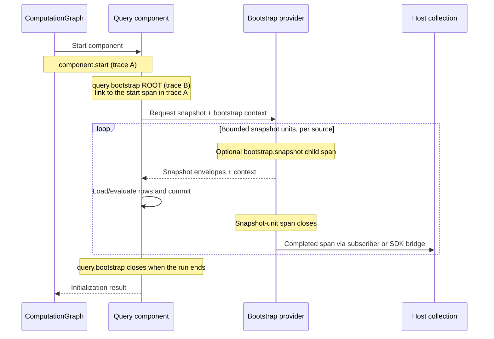
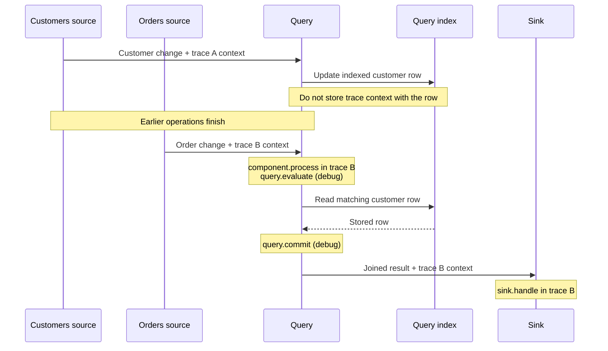
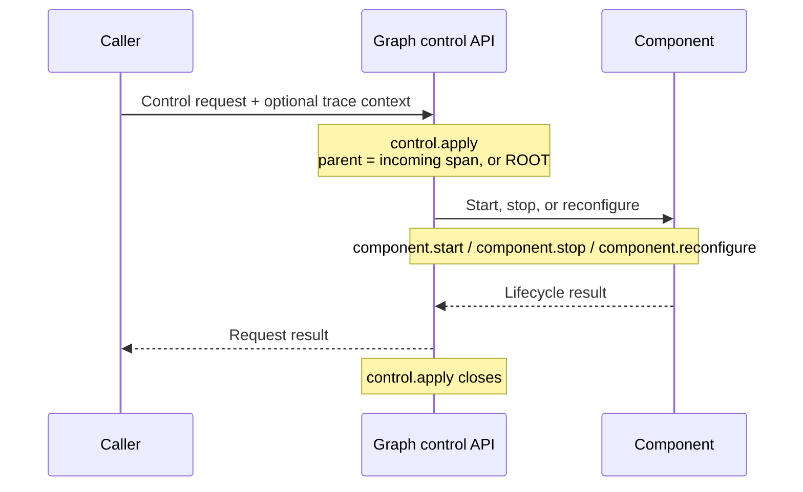

# Tracing for drasi-lib's Computation Graph

* Project Drasi - October 22, 2026 - Ruokun Niu (@ruokun-niu)
* Status: proposed replacement design; not implemented.
* Code baseline: drasi-core `8bb2a752`.

## Overview

<!-- Provide a succinct high-level description of the component or feature and where/how it fits in the big picture. The overview should be one to three paragraphs long and should be understandable by someone outside Drasi team. -->

This document defines how traces connect events and operations in ComputationGraph: source changes, transformer and query processing, sink handling, bootstrap, lifecycle calls, and scheduled evaluation. The graph supplies common spans; components add detail such as decoding or external requests.

Keep `tracing` as the emission API and the application (host) as the owner of subscribers, filtering, export, and shutdown. Statically linked components use the host's normal tracing infrastructure. Native plugins use a shared SDK bridge to receive context and return completed spans and log events without owning exporters.

The [overview](computation-graph-observability.md) defines shared ownership, profiles, and delivery slices; [metrics](computation-graph-metrics.md) defines measurements and recorder integration. Span names, context-carrier details, and bridge limits below remain proposals.

## Terms and definitions

<!-- These terms are internal to your design and will not be shared publicly. -->

| Term | Definition |
|------|------------|
| Host | Drasi Server or another application embedding drasi-lib. |
| Trace / span | A trace connects related operations; a span describes one operation's timing and outcome. |
| Trace context | Serializable trace ID, parent span ID, sampling flags, and optional bounded W3C trace state. Not a live Rust span. |
| Native plugin | A component loaded through the computation ABI; distinct from the legacy Source/Reaction ABI. |
| Attempt | One execution of work, which may be retried without changing its logical event identity. |

## Objectives

<!-- Describes goals/non-goals and user-scenario of this feature to understand the end-user goals.

- If the feature shares the same objectives of the existing design, link the existing doc rather than repeat the same context.
- If the feature has a scenario, UX, or other product feature design doc, link it here and summarize the important parts. -->

### User scenarios

<!-- Describe the user scenarios for this design. Ensure that you define the roles and personas in these user scenarios when it requires API design. -->

A developer follows a change across graph components and native plugins, while an embedder retains control of application logging and trace export.

### Goals

Reuse graph execution and component logging, preserve trace parentage and timing, and distinguish processing from forwarding and declared completion.

## Design requirements

### Requirements

<!-- List design goals or constraints that impact the design. Examples include extensibility points, maintainability, code reuse, considering if your feature needs to be taken down-level and coherency with related code. -->

1. Cover graph-owned production, admission, processing, continuations, scheduled work, forwarding, and sink batches.
2. Separate acceptance, processing, commit, forwarding, handling, and acknowledgement.
3. Propagate context explicitly across asynchronous tasks, queues, and native plugin calls without changing business/replay identities.
4. Preserve plugin span IDs, parentage/links, and timing at host collection.
5. Bound telemetry buffering, report loss, and keep exporter I/O outside graph processing.
6. Support both Tokio runtime flavors, preserve ordinary logs/inspection when tracing is off, and install no process-global subscriber implicitly.

### Dependencies

<!-- Describe the key dependencies that this design has on other features being developed as well as the dependencies other features have on this design. For example, supporting AWS resource has multiple feature dependencies with Bicep types, UCP, CoreRP, LinkRP, and CLI. This section summarizes such dependencies with the design document links. -->

Reuse `tracing`, graph-owned execution/lifecycle, and component logging. Shared context data belongs in the computation contracts; the computation ABI, plugin SDK, and Host SDK supply the native bridge. The native SDK must not depend on drasi-lib or the query engine.

The host trace adapter maps between `tracing` spans and portable context. An OpenTelemetry implementation uses `tracing-opentelemetry` plus a completed-span adapter; the evaluator does not depend on the OpenTelemetry SDK.

### Out of scope

<!-- Describe the important issues or concerns NOT addressed by this proposal. 1 paragraph each (can be short). Often the "out of scope" items refer to the current state. We might already have planned work to address the "out of scope" items, mention it if that's the case. -->

Metric instruments and source-to-sink timing samples belong to the [metrics design](computation-graph-metrics.md).

## Design

### High-level design

<!-- Provide a high-level description, using diagrams as appropriate, and top-level explanations to convey the architectural/design overview. Don't go into a lot of details yet but provide enough information so that the relationship between these components and other components. Call out or highlight new components that are not part of this feature (dependencies). This diagram generally treats the components as black boxes. Provide a pointer to a more detailed design document, if one exists. If you have the alternatives for your design, describe alternative solution too. -->

There are two distinct flows:

1. **Trace context travels with events and operation calls.** Receiving operations use the sender's context to join the trace.
2. **Completed spans and log events go to host collection.** This is separate from event delivery between components.

The change from the previous design is instrumentation placement: shared graph execution and pipe boundaries replace the fixed five-task Source -> Query -> Reaction pipeline. Component-specific spans remain underneath those common operations.

### Detail design

### Tracing a Statically Linked Build

Built-in components and statically linked plugins are ordinary Rust crates in the host binary. Their `tracing` calls reach the same host-installed subscriber as graph instrumentation. **There is no FFI telemetry transport in this path.**

The graph creates a span around each instrumented operation. While a component is being processed under that span, its internal spans nest normally. 
This is illustrative component code, not a new SDK API. The host still chooses the subscriber, filtering, and exporter.

Static linking removes the FFI boundary, not the need to propagate context. Unlike the old span-handle carrier, the proposed queue carrier holds trace identity without keeping the sending span alive.

The host must keep exporter I/O off graph processing paths and bound its processor/exporter buffers. Static spans do not need the native completed-span handoff below.

### Tracing a Dynamically Loaded Build

A native plugin cannot use the host's live Rust subscriber or span handles across the ABI. The SDK connects the plugin's local `tracing` infrastructure to a host-owned binding instead. Component authors still add ordinary spans; the SDK handles context and completed-span transport.


| Direction | Data | Handling |
|-----------|------|----------|
| Host -> plugin operation | Trace context, scope, optional opaque timing token | SDK enters context while polling the operation; a batch receives the graph-created batch span's context, not an arbitrary input's context. Spawned workers require explicit propagation. |
| Plugin -> host output | Event envelope plus separate execution context | Host continues the trace without changing envelope hashes. |
| Plugin -> host completed span | Name/scope, IDs, parent/links, flags, timestamps, status, bounded safe attributes/events | Host adapter preserves identity/timing and uses the bounded, nonblocking handoff below; submission reports acceptance or rejection. |
| Plugin -> host log event | Level, message, safe fields, component scope, optional trace IDs | Host routes it to the bounded component-log path once; trace sampling does not discard ordinary logs. |

For example, a host operation has span **H** in trace **T**. The SDK gives the plugin that context, and the plugin creates internal span **P** with parent **H**. When **P** finishes, its completed record returns to the host with the original IDs and start/end times. The host submits **P**, not a newly created replacement span. In the opposite direction, a source plugin can create a production span or adopt upstream context and return that context with its output.

Completed plugin spans cannot be recreated with `info_span!()` and keep their original IDs/times. The host therefore provides a completed-span adapter alongside its normal tracing layer. With OpenTelemetry, both feed the configured trace backend and share resource identity, filtering, sampling policy, and shutdown ownership. Callback arrival time is not the span's completion time.

#### Completed-span buffering and loss

The host owns a bounded handoff from native callbacks to a background span-processing worker. Its contract is:

- **Capacity:** configure finite, positive record-count and encoded-byte budgets across all native bindings using that handoff, as well as a maximum record size. Reservations and in-flight records count against these budgets; existing field/count limits also bound decoded allocations. The byte budget must accommodate at least one maximum-size record. Exact default sizes remain a sizing decision, but enabled setup must resolve valid limits or fail explicitly; there is no unbounded mode.
- **Submission:** check scope and encoded size, then reserve capacity without waiting before copying or decoding. Validate the remaining fields and retain owned data before returning; release the reservation on rejection. Attempt admission once; never wait for queue space, perform exporter I/O, retry, or spawn a task per span. Return an explicit accepted/full/invalid/closed outcome. Acceptance means retained for processing, not successfully exported.
- **Overflow:** when either budget is exhausted, drop the incoming record (drop newest), preserving already accepted records. Oversized, malformed, or stale-generation records are rejected as invalid; a closed sink rejects new submissions. The SDK does not retry rejected records or accumulate a fallback backlog. Any additional SDK, processor, or exporter buffers must also be bounded.
- **Loss reporting:** count each discarded record once at the layer that discards it, using unsampled local counters with bounded reason categories such as full, invalid, closed, and shutdown timeout. SDK-side failures are counted locally; a host-reported rejection is not counted again by the SDK. Counters remain readable through local diagnostics independently of this queue or metric export. Emit rate-limited summaries through the existing log path, without creating spans or recursively reporting failures of that diagnostic path. Intentional filtering, sampling, or disablement is not loss; downstream exporter loss is reported separately by the host.
- **Processing and shutdown:** losing a completed span must not fail the component operation, alter its result, or remove propagated trace context. Stop producers before closing admission, keep callback owners alive until producers and in-flight callbacks finish, then drain accepted records within the host's shutdown deadline. Count any records discarded at that deadline before shutting down export.

Implementation verification must stall the consumer and exceed each budget independently: callbacks must return without waiting for capacity, retained records must remain within the limits, and loss counts must match rejected submissions. Also cover concurrent producers, invalid/stale records, closed admission, and shutdown timeout without recursive diagnostics or component failures.

The [span catalogue](#span-names-and-instrumentation) defines emission ownership and attributes; the [API design](#api-design) shows the proposed trace records.

### Example Span Flow

These examples use the proposed span vocabulary and illustrative component IDs. They show instrumentation to add at existing runtime boundaries, not telemetry already implemented. Participants represent components and interfaces, not a fixed set of Tokio tasks. Internal span names such as `http.post` and `bootstrap.snapshot` are examples of optional component detail.

#### Source Change flow

This example follows one change through a transformer, a query, and a sink. Other graphs can omit stages, chain them, or fan out. The source may supply upstream context; otherwise the graph starts the trace at `source.publish` once the change is available.




Each transfer uses the configured pipe. Debug `pipe.send` spans measure forwarding/acceptance and backpressure separately from component processing. A transformer may produce zero, one, or many outputs; no output legitimately ends a branch, while fan-out creates downstream child operations in the same trace.

Where invoked, the proposed debug spans `component.confirm_outputs` and `pipe.acknowledge` show the separate output-confirmation and acknowledgement calls. Neither means that an external effect completed.

A successful sink call means only its declared **Accepted** or **Handled** boundary. An acceptance-only sink's internal queue needs its own context propagation and processing spans before a trace can show later delivery. A failed or cancelled batch does not imply that all external effects were rolled back.

When a sink combines inputs, apply the [batch parent and link policy](#batch-parent-and-link-policy) rather than inheriting an arbitrary input's trace.

#### Bootstrap flow

Bootstrap loads a query's initial snapshot rather than following a new source change. Use a separate `query.bootstrap` root linked to the start operation. Context also enters the snapshot provider, using ordinary tracing for static providers or the shared SDK bridge for native providers.



Use bounded per-source snapshot spans rather than one span per row. Row counts remain metrics, independent of trace sampling.

**A separate trace does not imply background execution.** At the reviewed revision, [query startup][query-start] awaits [recovery/bootstrap initialization][query-bootstrap]. Its lifecycle span can therefore include bootstrap time. This tracing design does not change that waiting or readiness contract, unlike the old example that assumed startup returned before bootstrap finished.


#### Cross-source join flow

Each source change keeps its own trace. Suppose an `Orders` change matches a `Customers` row that arrived earlier. The query reads that row from its index; it does not receive the earlier customer event again.



The join and its result belong to the triggering order change's trace. There is no second parent to invent from the stored customer row, and no persisted trace history in the index. This shows the current evaluation, not every historical event that contributed data.

#### Non-event flow: the future queue

A temporal query can produce a result without a new source change. ComputationGraph already reaches query due processing through [transformer wakeups/continuations][query-scheduled] or a [scheduled-notification source][scheduled-source]. Observability uses those paths; it does not add a scheduler.

Waiting for a due time and notifying the query are not themselves future evaluation. Query-specific instrumentation confirms that a due item exists before starting the shared `component.scheduled` operation span.

| Step | Where | Trace behavior |
|------|-------|----------------|
| 1 | Earlier change evaluation | Schedule the future; do not persist the event's trace context with it. |
| 2 | Existing scheduling path | Wait or send a due-work notification; do not create a future-evaluation trace for each notification. |
| 3 | Query due-processing path | If an item is due, start an attempt trace with `component.scheduled`; if nothing is due, there is no future-evaluation trace. |
| 4 | Query evaluation/storage | Add `query.evaluate` and `query.commit` detail under the scheduled operation when the debug profile enables them. |
| 5 | Graph forwarding and sink | Carry the scheduled operation's context with any results; use the normal pipe and sink spans. |
| 6 | End of the unit | Close the local operation span; additional due items use bounded processing units/continuations. |


Evaluating a due item that produces no result still creates a processing trace; that differs from a notification that finds no due item. The later trace does not span the waiting interval or claim uninterrupted timing across restart.


#### Control-plane flow

A control operation gets a span for the call itself, with the actual lifecycle operation beneath it. The example below shows a caller awaiting a graph operation; it does not prescribe a new management API.



Measure the API's actual completion boundary: an acceptance-only request does not prove readiness, while an awaited start includes initialization. Bootstrap uses the separate linked trace above. Later source changes start or adopt their own traces rather than inheriting a long-lived startup span.

Here `control.apply` describes a library/graph control request. Instrumenting every server HTTP request is separate server work.


### Span Names and Instrumentation

The tables below specify each proposed span's owner, frequency, interval, and fields, following the [original catalogue's format](01-tracing.md#span-naming-and-namespacing). Names and attributes remain proposals.

Two additional debug spans, `component.confirm_outputs` and `pipe.acknowledge`, expose existing [component][component-operations] and [pipe][pipe-operations] boundaries rather than adding delivery machinery.

#### Naming and shared fields

Names are lowercase and dot-separated, without a `drasi.` prefix, instance names, or unit suffixes. Identity belongs in attributes:

| Fields | Meaning |
|--------|---------|
| `instance_id`, `graph_id` | The hosting instance and authoritative graph. |
| `component_id`, `component_kind`, `role`, `generation` | The actual component and replacement generation, when the span belongs to a component. |
| `plugin_kind` | The declared plugin kind, when known; not a replacement for component identity. |
| `operation` | The specific call or operation category where a generic span name needs qualification. |
| `outcome` | `success`, `error`, or `cancelled` at this span's local boundary. |
| `error_kind` | A bounded error classification when applicable, not the raw error message. |

Trace IDs, parent IDs, links, and timestamps are trace metadata, not substitute identity attributes. Host-assigned scope cannot be overridden by plugin fields. Generation and trace identifiers do not become metric labels.

In the tables, `input_count` and `output_count` count envelopes; `change_count` counts input changes; `result_change_count` counts computed result-row changes, not delivered results. Record counts only when known at the operation boundary. Do not inspect payloads just to populate telemetry, or substitute zero for unavailable information.

Use local monotonic timing for internal durations, not differences between event timestamps. `basic` entries also apply under `debug` and `persistence`; `debug` entries are additional detail selected by the debug profile. Host sampling still applies to spans.

#### Source ingress

| Span | Emitted by / frequency | Starts -> ends | Additional fields | Profile |
|------|------------------------|----------------|-------------------|---------|
| `source.publish` | Graph source execution; once per output-envelope publication attempt | Once the event is available and graph publication begins -> the publication attempt returns, fails, or is cancelled | `output_port`, `publication_mode=polled/admitted`, `change_count` | basic |

This excludes idle waiting in `next()`. Admission-based sources use their actual graph admission/publication boundary. Upstream reads and decoding belong to source-internal spans; an upstream production span can become the publication's parent when its context accompanies the output.

A failed publication may already have reached some destinations. Its outcome does not imply rollback of earlier acceptance.

#### Transformer and query processing

| Span | Emitted by / frequency | Starts -> ends | Additional fields | Profile |
|------|------------------------|----------------|-------------------|---------|
| `component.process` | Graph execution; once per input-processing call or input-driven continuation | Invoke `transform` or `continue_transform` -> that call returns, fails, or is cancelled | `operation=transform/continue_transform`, `input_port` when applicable, `input_count`, `output_count` | basic |
| `query.evaluate` | Query implementation; once per instrumented evaluation unit | Enter the inner evaluator -> evaluation results are available, excluding the outer result hook and commit | `query_id`, `change_count`, `result_change_count` | debug |
| `query.commit` | Query implementation; once per actual query-owned storage commit | Begin the commit -> its result is known or the call is interrupted | `query_id` | debug |
| `component.confirm_outputs` | Graph execution; once per invocation of the existing `delivery_completed` hook | After outgoing branches accept the emission batch, invoke the hook -> the hook returns or is interrupted | `output_count` | debug; proposed addition |

A query reuses `component.process` with `component_kind=query`; it does not need a second `query.process` span around the same call. Query detail is nested beneath the relevant processing operation. The outer call can include storage I/O and is not a CPU-time measurement.

Processing excludes subsequent forwarding, output confirmation, and acknowledgement. An input-driven continuation consumes no new input envelope, even if it emits additional output. Output confirmation can receive an empty emission batch and is not downstream handling.

Only record an evaluator or commit span when that operation actually runs. Output-only replay does not imply another evaluation. The bootstrap policy below does not introduce per-row evaluator/commit spans.

#### Pipes and sink handling

| Span | Emitted by / frequency | Starts -> ends | Additional fields | Profile |
|------|------------------------|----------------|-------------------|---------|
| `pipe.send` | Actual pipe acceptance boundary; once per send, not once per logical edge sharing that send | Begin acceptance, including capacity wait -> receipt, failure, or cancellation | `queue_id`, `output_port` when known, `acceptance=accepted/not_accepted/unknown` | debug |
| `sink.handle` | Graph sink execution; once per single-input handler call | Invoke `handle` -> its declared completion boundary or an error/cancellation | `input_port`, `input_count=1`, `change_count`, `completion=accepted/handled` | basic |
| `sink.handle_batch` | Graph sink execution; once per actual batch-handler call | Invoke `handle_batch` after batch collection -> the batch call returns or is interrupted | `input_port`, `input_count`, `change_count`, `completion=accepted/handled`, `links_truncated` | basic |
| `pipe.acknowledge` | Graph/provider acknowledgement boundary; only when a supported acknowledgement handle is actually completed | Invoke `Acknowledgement::complete` -> the provider accepts the reported outcome or returns an error/cancellation | `queue_id`, `input_port` when known, `handling_outcome=handled/failed` | debug; proposed addition |

`pipe.send` ends at the provider's acceptance boundary, not at dequeue or handling. A declared lossy pipe can accept and discard an event. Durable acceptance ambiguity and cancellation must not be reported as definite nonacceptance. Shared queues and multicast record the actual send once.

Batch collection time is outside `sink.handle_batch`. Its `completion` field describes the sink's contract; only a successful call reaches that boundary. Failure or cancellation does not prove that partial external effects were rolled back.

Successful acknowledgement means the provider accepted the reported handling outcome, not an end-to-end commit. Dropping a delivery is not acknowledgement, and an acceptance-only sink cannot be upgraded to handled completion. Retrospective queue-residence spans remain separate follow-up work.

##### Batch parent and link policy

The graph chooses the parent and links before creating `sink.handle_batch`, using the inputs in the order passed to the handler. The same rule applies to static and native sinks:

| Input contexts | Batch span |
|----------------|------------|
| A nonempty batch whose inputs all carry the same valid `TraceContextV1` | Create a child of that context in the same trace; no redundant links. This includes a single-input batch. |
| No input carries valid context | Create a new root with no links. |
| Otherwise: different contexts, or a mixture of contextual and context-free inputs | Create a new root with links to the valid input contexts, subject to the limits below. Different parent spans in the same trace also use this rule. |

A new root has no implicit parent from the batch collector's current span. Invalid contexts are diagnosed through the existing validation path and treated as absent for this decision, without rejecting otherwise valid input data.

**Link selection and limits.** Use a finite, positive host-configured link-count limit compatible with the host adapter, processor/exporter, and native record limits. Numeric defaults remain a sizing decision. Retain the first distinct contexts in batch order, deduplicating by `(trace_id, span_id)`; the first occurrence supplies the link's flags and trace state. Stop retaining new contexts when the count or span-record byte budget is reached. Keep only the bounded retained set, not an unbounded intermediate link list. Set `links_truncated=true` if any valid input context is left unrepresented because of these limits; otherwise set it to false. Link omission does not drop inputs or change the handler's batch.

**Sampling.** A child batch inherits its parent's sampling decision. For a new root, supply the retained links and truncation flag before the host's root sampler runs, and make one decision for the batch. Linked inputs keep their original sampling flags; there is no automatic OR of those flags or implicit choice of one input as the sampling parent. A host sampler may use the bounded links. Propagate the batch context even when its span is unsampled; plugin children inherit that decision, while enabled metrics remain independent.

**Callback context.** The operation-level `ExecutionContext.trace` passed to a native batch callback identifies the graph-created `sink.handle_batch` span, with its trace ID, new span ID, and sampling flags. The SDK enters that context while polling the callback, so component-authored spans become children of the batch span; it neither chooses another input parent nor creates a duplicate batch wrapper. Static callbacks run under the same batch span. Individual input execution contexts remain attached to their inputs, separate from the operation context; none of this metadata is written into durable event data.

For example, inputs `(trace A, span a)` and `(trace B, span b)` produce batch root `(trace C, span c)` linked to both when they fit the budget. The native callback receives `(C, c)`, and an internal `http.post` span has parent `c`, not `a` or `b`.

Verify identical, absent, mixed, and same-trace/different-parent contexts; duplicate links; count/byte truncation; conflicting input sampling decisions; and native child parentage under both sampled and unsampled batch roots.

#### Bootstrap and scheduled processing

| Span | Emitted by / frequency | Starts -> ends | Additional fields | Profile |
|------|------------------------|----------------|-------------------|---------|
| `query.bootstrap` | Query implementation; once per actual bootstrap run | Bootstrap initialization/loading begins -> the run completes, fails, or is cancelled | `query_id`, `source_count` when known, `input_count`, `change_count` | basic |
| `component.scheduled` | Shared graph/query instrumentation; once per confirmed scheduled-processing unit, not each wakeup notification | Begin the actual bounded unit -> its local processing completes or is interrupted | `operation`, `work_kind` such as `future_queue` or `output_replay`, `output_count` | basic |

Bootstrap is a separate root linked to its start operation. Use aggregate run spans and bounded provider/snapshot spans rather than a span for each snapshot row. The current query startup still awaits its required initialization.

Choose `component.process` or `component.scheduled` for a given processing unit, not both as duplicate wrappers. A scheduled evaluation with no results is still processing; a notification that finds nothing due is not. Identify scheduled activity by its kind, not a reserved source name.

#### Lifecycle and control

| Span | Emitted by / frequency | Starts -> ends | Additional fields | Profile |
|------|------------------------|----------------|-------------------|---------|
| `component.start` | Graph lifecycle execution; once per actual start invocation | Invoke component startup -> its result, including initialization the call awaits | Shared component fields | basic |
| `component.stop` | Graph lifecycle execution; once per actual stop invocation | Invoke stop/cleanup -> the call returns or is interrupted | Shared component fields | basic |
| `component.reconfigure` | Graph lifecycle execution; once per reconfiguration invocation | Invoke reconfiguration -> its result or interruption | Shared component fields; no configuration contents | basic |
| `control.apply` | Library/graph control boundary; once per request | Receive the request -> the API's declared acceptance/completion response | `operation`, `component_id` for a single-component target, `target_count` when known | basic |

An accepted control request does not imply component readiness. Similarly, closing a cancelled or failed stop span does not prove that worker cleanup finished.

#### Component-specific detail

Graph-owned spans are emitted once regardless of static or dynamic linking. Components can add narrower spans underneath them; the SDK transports native-plugin records without adding a duplicate wrapper for the same graph call.

These names are illustrative additions a component author might use, not another mandatory SDK span catalogue:

| Span | Component-owned interval | Safe example fields |
|------|--------------------------|---------------------|
| `source.fetch` | One upstream read/poll operation | `record_count`, bounded `protocol` |
| `source.decode` | Decode an available record or batch | `record_count` |
| `transformer.normalize` | Normalize records inside an input-processing call | `input_record_count`, `output_record_count` |
| `bootstrap.snapshot` | One bounded source snapshot unit | `source_id`, `change_count` |
| `http.post` | One outbound HTTP request | `status_code`; no URL, headers, or body |

Source fetch/decode spans can precede publication; they cannot be children of a publication span that has not started. Services and ordinary Source/Reaction adapters need instrumentation at their actual internal processing boundaries: a portless lifecycle wrapper cannot observe every background operation. Assign one owner to each framework observation rather than counting it in both wrapper and adapter.


### Profiles, Sampling, and Logging

Use the [shared profiles](computation-graph-observability.md#2-proposed-shared-profiles). Sampling is a trace-only host policy: respect the selected parent's sampling decision, and choose new-root sampling once. Child spans keep the decision; batches use the explicit [parent, link, and sampling policy](#batch-parent-and-link-policy) above. Enabled metrics are not sampled.

Apply filters per layer so disabling new traces does not suppress log events or the spans needed for component-log routing. Preserve the existing log-to-tracing bridge. A convenience initializer may install defaults only when explicitly called and must report an existing-subscriber conflict.

Disabling trace export leaves the plugin log path available. Plugin authors optionally add internal spans; framework operation spans remain host-owned.

### API Design


These are proposed API responsibilities, not claims that the functions already exist:

| Surface | Contract |
|---------|----------|
| `init_component_logging()` | Returns a `ComponentLogRuntime`: registry, layer, bounded worker ownership, and awaited drain/shutdown. Installs no globals. |
| `init_default_subscriber()` | Explicit convenience setup; returns ownership or an error, never silently ignores a subscriber conflict. |
| `DrasiLibBuilder::with_telemetry(...)` | Receives collection settings and optional context-adapter capability; no implicit global installation. Direct graph builders need equivalent settings. |
| Host trace-context adapter | Supports an explicit parent or root, bounded links and attributes supplied before sampling, and extraction of the resulting operation context even when unsampled. |
| Host SDK telemetry binding | Attaches the host context adapter, completed-span sink, and log routing before plugin construction, alongside the metric callbacks. |
| Completed-span sink | Resolves host-owned count/byte limits and provides nonblocking submission with explicit accepted/full/invalid/closed outcomes, local loss diagnostics, and deadline-bounded draining. See the [handoff contract](#completed-span-buffering-and-loss). |
| Execution-context carrier | Adds transient metadata to runtime deliveries and versioned plugin frames. Its Rust placement must be reviewed with public input/output types; it is not a silent wire-field addition. |

Default construction preserves logs/inspection and leaves new collection off. Install the subscriber and native telemetry bindings before component construction. Explicitly enabled distributed tracing requires a context adapter; missing capability is reported, not silently presented as connected tracing.

No library REST, CLI, or Go API is added. Server changes are in the companion design.

#### Trace data types (proposed)

The SDK and host integration need two different data shapes: context carried with an operation, and a completed span sent to collection. The following is a concrete Rust sketch for the shared computation contracts, using the existing `serde` dependency. It is not a finalized ABI layout.

```rust
use serde::{Deserialize, Serialize};

#[derive(Clone, Debug, PartialEq, Eq, Serialize, Deserialize)]
#[serde(deny_unknown_fields)]
pub struct TraceContextV1 {
    pub trace_id: [u8; 16],
    pub span_id: [u8; 8],
    pub trace_flags: u8,
    pub trace_state: Option<String>,
}

#[derive(Clone, Debug, Default)]
pub struct ExecutionContext {
    pub trace: Option<TraceContextV1>,
}

pub type SpanAttributesV1 = Vec<(String, AttributeValueV1)>;

#[derive(Clone, Debug, PartialEq, Serialize, Deserialize)]
pub enum AttributeValueV1 {
    Bool(bool),
    I64(i64),
    F64(f64),
    String(String),
}

#[derive(Clone, Debug, PartialEq, Eq, Serialize, Deserialize)]
pub enum SpanStatusV1 {
    Unset,
    Ok,
    Error,
}

#[derive(Clone, Debug, PartialEq, Serialize, Deserialize)]
#[serde(deny_unknown_fields)]
pub struct SpanLinkV1 {
    pub context: TraceContextV1,
    pub attributes: SpanAttributesV1,
}

#[derive(Clone, Debug, PartialEq, Serialize, Deserialize)]
#[serde(deny_unknown_fields)]
pub struct SpanEventV1 {
    pub name: String,
    pub time_unix_ns: u64,
    pub attributes: SpanAttributesV1,
}

#[derive(Clone, Debug, PartialEq, Serialize, Deserialize)]
#[serde(deny_unknown_fields)]
pub struct CompletedSpanV1 {
    pub name: String,
    pub target: String,
    pub context: TraceContextV1,
    pub parent_span_id: Option<[u8; 8]>,
    pub links: Vec<SpanLinkV1>,
    pub start_time_unix_ns: u64,
    pub end_time_unix_ns: u64,
    pub status: SpanStatusV1,
    pub attributes: SpanAttributesV1,
    pub events: Vec<SpanEventV1>,
}
```

- **Context propagation:** `TraceContextV1.span_id` identifies the sending span when passed to another operation. A single-input receiving operation uses it as its parent and gets its own span ID; a batch uses the [parent/link policy](#batch-parent-and-link-policy). Native callbacks receive the resulting operation span's context, separately from any per-input contexts. `None` in `ExecutionContext.trace` means no supplied context, not an all-zero trace ID.
- **Completed records:** `CompletedSpanV1.context` identifies the completed span itself; `parent_span_id` is separate and is `None` for a root. Links can refer to other traces. The host preserves these identities and original timestamps instead of creating a replacement span. Unix timestamps describe the trace timeline; internal duration measurements still use local monotonic timers.
- **Runtime placement:** execution context accompanies input/output deliveries separately from the serialized event envelope and its receipt digest. This sketch shows only its trace portion; optional timing-token metadata is covered by the metrics design. It is not added to indexed rows, journals, outboxes, or hashed annotations.
- **Native transport:** encode the V1 records as bounded MessagePack in the negotiated computation-ABI extension's operation frames/callbacks. These Rust structs, including their `String` and `Vec` fields, do not cross FFI by memory layout. No live Rust spans, trait objects, or `Instant` values cross the boundary.
- **Scope and validation:** the host-assigned callback binding supplies instance/component identity and generation; plugin attributes cannot override it. Encoders/decoders must enforce record, string, attribute, event, and link limits, validate IDs and trace state, and report rejected data. The ordinary Rust containers above do not enforce those limits themselves. This first sketch uses scalar attributes; numeric normalization must be checked rather than silently narrowed.

The SDK constructs these records from `tracing` observations. Component authors normally do not construct them or call the transport callbacks directly.

#### Adding component-specific spans

Suppose a transformer calls this helper from its normal processing callback. The graph/SDK integration already has `component.process` active while polling that callback. The helper adds one child span and records its output count after normalization:

```rust
use tracing::{field, Instrument};

pub async fn normalize_records(records: Vec<String>) -> Vec<String> {
    let span = tracing::info_span!(
        "transformer.normalize",
        input_record_count = records.len(),
        output_record_count = field::Empty,
    );

    async move {
        let output: Vec<String> = records
            .into_iter()
            .map(|record| record.trim().to_owned())
            .filter(|record| !record.is_empty())
            .collect();

        tracing::Span::current().record("output_record_count", output.len());
        output
    }
    .instrument(span)
    .await
}
```

For three input records with one empty after trimming, the trace contains:

```text
component.process                         (graph-provided)
  +-- transformer.normalize
        input_record_count = 3
        output_record_count = 2
```

The component installs no subscriber, exporter, or FFI callback. Static builds emit directly to the host subscriber; a native build's SDK uses its scoped bridge. Only counts are recorded, not the record contents.

`.instrument(span)` enters the span each time the future is polled. Do not hold a `span.enter()` guard across `.await`. Spawning another task still requires explicit propagation of both tracing context and the SDK's host scope.

### Alternatives Considered

<!-- Describe the alternative designs that were considered or should be considered. Give a justification for why alternative approaches should be rejected if possible. -->

- **Instrument only ordinary Source/Reaction base types:** misses native transformers, queries, sinks, and admission/batch paths.
- **Recreate completed plugin spans as host spans:** loses the original IDs, parentage, and timing.
- **Put live spans or fresh attempt IDs in durable envelopes:** prolongs span lifetimes or changes retry hashes. Use separate transient context.

## Security

<!-- Optional. Use this section to describe the security threats and its mitigations with this design---such as authenticating request, storing secrets and credentials, etc. -->

Framework attributes are allow-listed identifiers, enums, counts, and timings. Exclude query text, payloads, SQL parameters, credentials, and full endpoint URLs. Validate upstream trace IDs and bound trace state; do not propagate arbitrary baggage by default.

Treat plugin records as untrusted: validate schema, sizes, IDs, attribute counts, and host scope. Export transport authentication and access control belong to the host.

## Compatibility impact

<!-- Optional. Describe the potential compatibility issues with the other components---such as incompatible with older CLI. Include breaking changes to behaviors or APIs here. -->

The initialization split deliberately changes the old implicit-global API and requires migration guidance. Existing component log subscriptions, snapshot APIs, and business/recovery formats are preserved.

Use the native ABI's separately versioned extension pattern; do not append fields to frozen base vtables or assume the legacy registration table is sufficient. Legacy plugin loading/logging remains supported, but full internal trace propagation there needs its own negotiated bridge. Rebuild actual cdylibs for compatibility tests.

## Appendices

<!-- Optional. Describe additional information supporting this design. For instance, describe the details of alternative design if you have one. -->

The old five-stage interval model is replaced by component processing and pipe boundaries. Queue waiting, evaluation, commit, and external handling remain distinct; none is automatically evaluator CPU time.

## References

<!-- Optional. Add the design documents and references you use for this document. -->

- [Shared overview](computation-graph-observability.md) and [metrics design](computation-graph-metrics.md)
- [Server integration design](../../drasi-server/computation-graph-observability-integration.md)
- [Original tracing design](01-tracing.md) and [observability proposal][proposal]
- [Graph execution at the reviewed revision][execution]
- [Query startup][query-start], [bootstrap initialization][query-bootstrap], and [scheduled processing][query-scheduled]
- [Scheduled-notification source][scheduled-source]
- [Native ABI extension example][abi]
- [Component processing/confirmation contract][component-operations] and [pipe acceptance/acknowledgement contract][pipe-operations]
- [Library architecture rules][lib-rules] and [component/plugin rules][component-rules]

[proposal]: https://github.com/drasi-project/design-documents/pull/7
[execution]: https://github.com/drasi-project/drasi-core/blob/8bb2a752/lib/src/computation/v1/graph.rs
[query-start]: https://github.com/drasi-project/drasi-core/blob/8bb2a752/lib/src/computation/v1/query.rs#L1526
[query-bootstrap]: https://github.com/drasi-project/drasi-core/blob/8bb2a752/lib/src/computation/v1/query_recovery.rs#L159
[query-scheduled]: https://github.com/drasi-project/drasi-core/blob/8bb2a752/lib/src/computation/v1/query.rs#L1663
[scheduled-source]: https://github.com/drasi-project/drasi-core/blob/8bb2a752/lib/src/computation/v1/query_scheduling.rs#L65
[identity]: https://github.com/drasi-project/drasi-core/blob/8bb2a752/components/computation-contracts/src/output_identity.rs
[abi]: https://github.com/drasi-project/drasi-core/blob/8bb2a752/components/computation-plugin-abi/src/batching.rs
[component-operations]: https://github.com/drasi-project/drasi-core/blob/8bb2a752/lib/src/computation/v1/component.rs#L134
[pipe-operations]: https://github.com/drasi-project/drasi-core/blob/8bb2a752/lib/src/computation/v1/pipe.rs#L21
[lib-rules]: https://github.com/drasi-project/drasi-core/blob/8bb2a752/lib/AGENTS.md
[component-rules]: https://github.com/drasi-project/drasi-core/blob/8bb2a752/components/AGENTS.md
