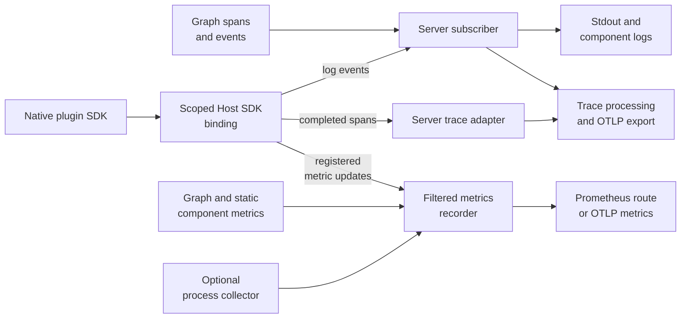
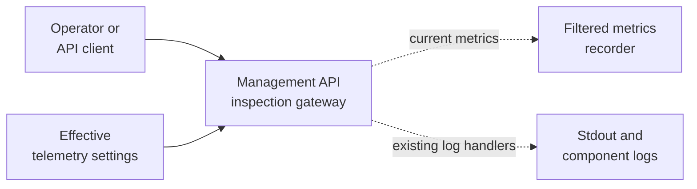

# Tracing / Logging / Metrics Integration for Drasi Server's Computation Graph

* Project Drasi - October 26, 2026 - Ruokun Niu (@ruokun-niu)
* Status: proposed replacement design; not implemented.
* Paired with the library [overview](../drasi-lib/tracing-logging/computation-graph-observability.md), [tracing](../drasi-lib/tracing-logging/computation-graph-tracing.md), and [metrics](../drasi-lib/tracing-logging/computation-graph-metrics.md) designs.

## Overview

<!-- Provide a succinct high-level description of the component or feature and where/how it fits in the big picture. The overview should be one to three paragraphs long and should be understandable by someone outside Drasi team. -->

**Drasi Server collects the graph's telemetry and exports it; it does not instrument a second execution pipeline.** drasi-lib measures sources, transformers, queries, sinks, services, and pipes at their authoritative execution boundaries. The server owns configuration, subscribers, recorders, bindings to the SDK's native-plugin telemetry bridge, exporters, and shutdown.

The original collection architecture stays: stdout/component logs, optional OTLP traces, and either Prometheus or OTLP metrics. Operators run their own backends and point the server at them. The graph model requires host integration for portable trace context, completed native-plugin spans, and scoped metric callbacks, not a new export backend. Process measurements remain server-owned.

Operators select the telemetry collection level in server YAML through `telemetry.profile`. An opt-in, read-only gateway on the existing management API exposes effective settings, available current metrics, and discovery of existing component-log endpoints. It is not a separate service, trace store, or proxy to external observability backends.

## Terms and definitions

<!-- These terms are internal to your design and will not be shared publicly. -->

| Term | Definition |
|------|------------|
| Graph telemetry | Component/pipe spans and measurements defined by the library design. |
| Trace adapter | Host integration that imports/exports context and accepts completed plugin spans. |
| Native telemetry binding | Host SDK callbacks scoped to a component instance; shared by trace, log, and metric transport. |
| Inspection gateway | Read-only management API access to local telemetry settings, available metrics, and existing component logs. |
| OTLP | OpenTelemetry's export protocol to a user-operated collector or backend. |
| Telemetry runtime | Server-owned collection/export handles and their shutdown lifetime; not another computation runtime. |

## Objectives

<!-- Describes goals/non-goals and user-scenario of this feature to understand the end-user goals.

- If the feature shares the same objectives of the existing design, link the existing doc rather than repeat the same context.
- If the feature has a scenario, UX, or other product feature design doc, link it here and summarize the important parts. -->

### User scenarios

<!-- Describe the user scenarios for this design. Ensure that you define the roles and personas in these user scenarios when it requires API design. -->

1. **Developer running locally:** omit telemetry configuration and retain stdout logs and per-component log streams.
2. **Operator configuring and inspecting telemetry:** select a collection level in YAML, then inspect effective settings, current metrics, and component logs through the management API without a separate monitoring service. `/metrics` remains available for Prometheus scraping when configured.
3. **Operator exporting telemetry:** point traces and/or metrics at user-operated OTLP endpoints; see connected host/plugin spans without plugins owning exporters.
4. **Operator monitoring server resources:** enable process memory/CPU measurements through the selected metrics backend without attributing them to individual queries.
5. **Application hosting multiple Drasi instances:** keep same-named components and queues separate in exported telemetry.
6. **Operator terminating a server:** stop under SIGINT/SIGTERM and preserve shutdown diagnostics within the termination deadline.

### Goals

<!-- Describes goals to define why we need, where we go, and how we know whether we will be successful when we deliver this feature. -->

- Reuse the library's instrumentation, identities, names, and completion semantics.
- Preserve `ComponentLogLayer`, per-component log streaming, and existing `logLevel` behavior.
- Configure the telemetry collection level through YAML `telemetry.profile`, existing environment interpolation, builders, and `init`.
- Offer opt-in, read-only local inspection through the existing management API without changing collection policy on read.
- Export static and native-plugin telemetry through one host-owned collection policy.
- Keep slow/unavailable telemetry backends from stopping graph work.

### Non-Goals

<!-- Describe non-goals to identity something that we won't be focusing on immediately. We won't be expending any effort on these matters. -->

The server does not run a telemetry database or UI, retain recent traces, query external telemetry backends, add another graph observer registry, or attribute process RSS/CPU to individual components. This design covers in-process and native-cdylib components; separate-process host transport is a follow-up.

## Design requirements

### Requirements

<!-- List design goals or constraints that impact the design. Examples include extensibility points, maintainability, code reuse, considering if your feature needs to be taken down-level and coherency with related code. -->

1. Install collection before component/plugin construction, and preserve application logging when new telemetry is off.
2. Allow operators to configure the telemetry collection level in server YAML using `telemetry.profile: off | basic | debug | persistence`. Apply its filters, collection flags, and plugin enablement consistently; keep it separate from `logLevel`.
3. Export host and plugin spans with their original identities, not duplicate replacement spans.
4. Retain bounded worker/export ownership through shutdown; cancellation is not proof that component cleanup finished.
5. Diagnose invalid configuration, unsupported capabilities, telemetry loss, and export failures explicitly.
6. Keep enabled metric updates independent of trace sampling and outside droppable span queues.
7. Preserve instance, graph, component, and actual queue identity without adding trace IDs or generations as metric labels.
8. Preserve library business/replay formats and completion semantics; do not reconstruct them in the server.
9. Allow an opt-in, read-only inspection gateway on the management API for effective settings, available current metrics, and existing component logs. Inspection is independent of collection, preserves access controls, and reports unavailable capabilities explicitly.

### Dependencies

<!-- Describe the key dependencies that this design has on other features being developed as well as the dependencies other features have on this design. For example, supporting AWS resource has multiple feature dependencies with Bicep types, UCP, CoreRP, LinkRP, and CLI. This section summarizes such dependencies with the design document links. -->

The [tracing design](../drasi-lib/tracing-logging/computation-graph-tracing.md) supplies composable logging, spans, and context contracts. The [metrics design](../drasi-lib/tracing-logging/computation-graph-metrics.md) defines instruments and recorder callbacks. The [overview](../drasi-lib/tracing-logging/computation-graph-observability.md#2-proposed-shared-profiles) defines shared profiles; the Host SDK supplies the shared native telemetry binding.

The server selects versions of `tracing-opentelemetry`, OpenTelemetry SDK/OTLP exporters, `metrics-util`, `metrics-exporter-prometheus`, `metrics-exporter-otel`, and `metrics-process` compatible with the library's proposed `metrics 0.24` facade. Exporter dependencies remain here or in an optional host integration crate, not the evaluator or native SDK. Compatibility of the completed-span adapter and metric operations must be demonstrated with the selected versions.

Inspection reuses the [v1 management router and component-log routes][server-routes], retained Prometheus handle, and [shared error contract][server-api-errors]. These conventions were checked at server revision `1fc9e7bf`; the telemetry inspection routes below are new proposals.

## Design

### High-level design

<!-- Provide a high-level description, using diagrams as appropriate, and top-level explanations to convey the architectural/design overview. Don't go into a lot of details yet but provide enough information so that the relationship between these components and other components. Call out or highlight new components that are not part of this feature (dependencies). This diagram generally treats the components as black boxes. Provide a pointer to a more detailed design document, if one exists. If you have the alternatives for your design, describe alternative solution too. -->

One server-owned telemetry runtime composes:

- Component log routing and stdout formatting.
- A host tracing layer plus a completed-plugin-span adapter, sharing export policy.
- One metrics recorder, optionally receiving server process metrics.
- Handles for bounded draining, flushing, and shutdown.

Instances share this collection infrastructure but keep their own identities. This design applies the server's effective profile to each hosted instance; per-instance configuration overrides are not introduced. Plugin authors never receive exporter credentials.

#### What changes from the original server proposal?

**Server integration is still required, but the graph change does not require a new collection architecture.**

| Surface | Retained from the original proposal | Computation-graph adaptation |
|---------|-------------------------------------|------------------------------|
| Subscriber and exporters | Component logs, stdout, optional OTLP traces | Supply the portable-context adapter and completed-plugin-span export path; keep log filtering separate. |
| Metrics recorder | One Prometheus or OTLP backend | Accept the graph catalogue and scoped SDK registrations/updates without translating it back to the old pipeline. |
| Profiles | Shared filters and collection flags | Pass effective settings to graph construction and native bindings; do not enable deferred capabilities by selecting a profile. |
| Identity | Component attribution | Preserve `instance_id`, `graph_id`, and actual `queue_id`; host-owned bindings prevent cross-instance attribution. |
| Startup/shutdown | Initialize before work; stop producers before flushing | Bind the versioned native extension before plugin construction and retain/revoke/drain its ownership safely. |
| Process metrics and scrape route | Server-owned process collector and optional `/metrics` | No graph-specific redesign. |
| YAML level and inspection | Shared profiles and existing log APIs | Make the YAML level explicit and add opt-in management access to effective settings and current metrics. |

The graph, computation contracts, and SDKs own operation instrumentation, transient context carriers, metric handles, and ABI transport. The server supplies their host integration. It does not add a scheduler, observe every graph edge again, derive counters from spans, or infer handled delivery from queue acceptance. Existing subscribers/recorders can consume the new host-emitted signals; connected native-plugin internals additionally require the negotiated bridge and adapter.

### Architecture Diagram

<!-- Provide an architecture design if applicable. An architecture diagram should be provided when the design involves multiple parts of Drasi (Communication between RPs, Communication between CLI and RPs, Protocol changes for UCP, Communication with external systems like clouds, etc.) -->

**Telemetry collection and export**



**Read-only inspection**

The gateway reads the same recorder and component logs shown above. Dashed arrows indicate read-only access, not another collection path.



### Detail design

<!-- This section should be detailed and through enough that another developer could implement your design and provide enough detail to get a high confidence estimate of the cost to implement the feature but isn't as detailed as the code. Be sure to also consider testability in your design.

For each change, give each "change" in the proposal its own section and describe it in enough detail that someone else could implement it. Cover ALL of the important decisions like names. Your goal is to get agreement to proceed with coding and PRs.

If there are alternative you are considering please include that in the open questions section.

If the product has a layered architecture, it's good to align these sections with the product's layers. This will help readers use their current understanding to understand your ideas.

- **Advantages of this design** - Describe what's good about this plan relative to other options. Does it feel easy to implement? Provide flexibility for future work?
- **Disadvantages** - Describe what's not ideal about this plan. If you don't point these things out other people will do it for you. This is a good place to cover risks. -->

#### 1. Configuration

Retain the original optional `telemetry` section. This example enables traces and Prometheus metrics:

```yaml
apiVersion: drasi.io/v1
id: my-server
host: 0.0.0.0
port: 8080
logLevel: info

telemetry:
  profile: basic
  inspection:
    enabled: true
  filters:
    exclude: ["drasi.plugin."]
  tracing:
    endpoint: "http://localhost:4317"
    serviceName: "drasi-server"
    sampleRatio: 0.1
  metrics:
    backend: prometheus
    processMetrics: false
    prometheus:
      path: "/metrics"
  shutdownTimeoutSeconds: 5
```

The OTLP examples use gRPC endpoints. For OTLP metrics, select `backend: otlp` and provide `otlp.endpoint` and positive `otlp.exportInterval` in seconds. The optional `prometheus.port` starts a separate listener; without it, mount the route on the management API.

```yaml
telemetry:
  profile: basic
  metrics:
    backend: otlp
    processMetrics: true
    otlp:
      endpoint: "http://localhost:4317"
      exportInterval: 30
```

This second example enables metrics only. An OTLP metrics endpoint does not enable tracing.

| Setting | Default / rule |
|---------|----------------|
| No `telemetry` section | Existing logs/inspection only; no new collection, telemetry gateway routes, scrape route, or exporter connections |
| `profile` | Telemetry collection level; `basic` when the section is present; `off/basic/debug/persistence` use the [shared library definitions](../drasi-lib/tracing-logging/computation-graph-observability.md#2-proposed-shared-profiles) |
| `inspection.enabled` | False; mount read-only `/api/v1/telemetry` inspection routes on the existing management API when true, independently of profile/export enablement |
| `filters.exclude` | Empty; additional metric-name substring exclusions, not globs |
| `tracing.endpoint` | Absent disables OTLP trace export; an empty interpolated string is treated as absent |
| `tracing.serviceName` | `drasi-server`; also used for OTLP metric resource identity, including metrics-only configuration |
| `tracing.sampleRatio` | 1.0 for new roots; finite value in [0, 1], with parent-based sampling |
| `metrics.backend` | `none`; otherwise `prometheus` or `otlp` |
| `metrics.processMetrics` | False; when true requires an enabled metrics backend and non-off profile |
| `prometheus.path` | `/metrics`; absolute route, reject conflicts with existing routes |
| `prometheus.port` | Absent; if present, use the validated server address/port configuration |
| `otlp.exportInterval` | 30 seconds; finite positive integer |
| `shutdownTimeoutSeconds` | 5 seconds; shared telemetry drain/flush budget after component shutdown, not a component-cleanup timeout |

The sampling ratio and timing defaults are proposed defaults to benchmark, not existing configuration. Reject malformed endpoints, invalid numbers, conflicting routes/listeners, and ineffective requests such as process collection without an enabled backend. Only the selected metrics backend is instantiated; a non-selected backend's configuration does not start another exporter.

##### Profiles

**`telemetry.profile` is the YAML telemetry-level setting.** It selects collection presets, not a severity threshold or a new `telemetry.level` field. `logLevel` and the existing `RUST_LOG` policy continue to control ordinary logs.

| YAML value | Collection level |
|------------|------------------|
| `off` | No new traces/metrics; ordinary logs and inspection continue. |
| `basic` | Core graph-operation spans and operational metrics, excluding deferred instruments. |
| `debug` | Basic plus detailed pipe/query spans and permitted diagnostics. |
| `persistence` | Basic plus supported recovery/storage observations. |

The profile, inspection flag, and exporter configuration are startup settings: change YAML and restart the server to apply them. Unknown profiles fail validation rather than falling back to `basic`; the inspection API cannot change configuration.

Resolve the [shared profile](../drasi-lib/tracing-logging/computation-graph-observability.md#2-proposed-shared-profiles) once, then combine it with the enabled destinations:

| Output | Server application |
|--------|--------------------|
| Trace directives | Select host/plugin spans without suppressing ordinary logs or component-routing context. |
| Metric exclusions | Wrap the recorder and apply the same selection during scoped plugin registration. |
| Collection flags | Pass effective settings to `DrasiLibBuilder::with_telemetry(...)`, direct graph builders, native bindings, and relevant provider constructors. |

`profile: off` disables all new trace/metric collection and export, including Prometheus scrape listeners, even if endpoints are configured. Logs and existing inspection continue. When `inspection.enabled: true`, the new gateway remains available for settings and log discovery, but reports local metrics as unavailable rather than enabling collection. Under other profiles, a missing trace endpoint disables distributed trace export/context integration, not metrics or local log context. `backend: none` disables new metric collection, not tracing. Do not leave expensive collection enabled when its signal has no configured destination.

For inspection without new collection or exporter connections:

```yaml
telemetry:
  profile: off
  inspection:
    enabled: true
```

For local metric reads, select a non-off profile and `metrics.backend: prometheus`. Enabling inspection alone does not choose a recorder or enable trace export.

`persistence` selects supported recovery/storage observations, not every RocksDB statistic. Engine-specific statistics and handled-branch end-to-end timing remain gated by the library's delivery slices. A profile cannot manufacture them. Invalid profiles or explicitly requested unsupported capabilities are errors; older plugins lacking optional telemetry are diagnosed as described in section 2.

##### Filters

`filters.exclude` adds metric-name **substring** exclusions to the profile's deny list. `metrics_util::layers::FilterLayer` does not interpret globs: use `drasi.plugin.`, not `drasi.plugin.*`. Filters can suppress metrics but cannot enable collection absent from a profile or implementation. They do not sample metrics or change log filtering.

##### Environment interpolation

Use the existing configuration resolver rather than introducing a second environment-configuration system:

```yaml
telemetry:
  profile: "${DRASI_TELEMETRY_PROFILE:-basic}"
  tracing:
    endpoint: "${OTEL_ENDPOINT:-}"
  metrics:
    backend: "${METRICS_BACKEND:-prometheus}"
```

Resolve interpolation and typed values before validation. Arbitrary OpenTelemetry environment variables are not a promise that exporters install themselves. Preserve the existing `logLevel`/`RUST_LOG` precedence.

#### 2. Tracing Subscriber Setup

Follow the [library tracing contract](../drasi-lib/tracing-logging/computation-graph-tracing.md#api-design): create `ComponentLogRuntime` explicitly. Compose its layer, a stdout layer, and an optional OpenTelemetry trace layer into one subscriber. Preserve the existing `logLevel`/`RUST_LOG` resolution for logs; apply telemetry directives to the trace path without globally filtering away component-log context.

The server supplies the library's trace-context adapter. With OTLP enabled, it uses the configured tracer to extract parent IDs and attach incoming context. Without an endpoint, connected trace export is disabled; local span/log context can still be used by the subscriber. Enabling a profile alone must not imply an external trace export or a configured distributed-context adapter.


The same scoped Host SDK binding provides metric registration/update callbacks and a log-event callback into the component-log runtime. Trace sampling/off settings do not suppress ordinary plugin logs or the existing `log` bridge. Route each log event once. Register the binding before plugin construction. Optional plugin telemetry can be unavailable on an older plugin without preventing host-side operation spans; report that limitation in diagnostics.


The SDK/Host SDK owns bounded MessagePack transport through the separately versioned computation-ABI extension. The server binds the callbacks, not a new wire format or legacy-vtable extension. Transient `ExecutionContext`/`TraceContextV1` follows work separately from event envelopes, receipt hashes, indexes, and journals. Exporting to an OTLP endpoint is not upstream HTTP/gRPC context propagation; the component/protocol integration supplies that context.

#### 3. Metrics Recorder Setup

The server does not rename graph measurements or maintain a shadow status registry. Apply the [library metric names, identity labels, units, and count rules](../drasi-lib/tracing-logging/computation-graph-metrics.md).

| Backend | Server ownership |
|---------|------------------|
| Prometheus | Build `metrics_exporter_prometheus::PrometheusRecorder`, wrap it in `FilterLayer`, retain `PrometheusHandle`, and call `render()` at the scrape route. No second metric registry is needed. |
| OTLP | Build an OTLP metric exporter, `PeriodicReader`, and `SdkMeterProvider`; adapt its meter with `metrics_exporter_otel::OpenTelemetryRecorder`, wrap in `FilterLayer`, and retain the provider for flushing. The OpenTelemetry SDK alone is not a `metrics::Recorder`. |
| None | Do not install a recorder for this server; new metric collection is disabled. Never replace another application's recorder. |

Install before components cache handles. Existing subscriber/recorder conflicts are startup errors for standalone initialization; an embedded server must accept caller-provided collection handles instead of silently ignoring a failed global install. Supplied handles do not transfer ownership of the caller's process-global providers.

Use the same OpenTelemetry resource identity for traces and metrics: `service.name`, server version, and a process-start-unique `service.instance.id`. These resource fields do not replace `instance_id`/`graph_id` on Drasi measurements, since one server can host multiple instances.


Configure duration histograms with second-valued observations and buckets suitable for microseconds through seconds. A proposed explicit bucket set is `0.000001, 0.000005, 0.00001, 0.00005, 0.0001, 0.0005, 0.001, 0.005, 0.01, 0.05, 0.1, 0.5, 1, 5, 10`. Use it for the library's duration instruments, not every histogram. Configure the corresponding OpenTelemetry aggregation where supported and qualify the adapter's units, gauge operations, and histogram export; do not assume backend defaults are equivalent. Benchmark and document the final bucket set.

#### 4. Process Resource Metrics

When `metrics.processMetrics: true`, retain a `metrics_process::Collector`, describe its instruments, and emit through the selected recorder. These values describe the whole server process, not one Drasi instance, query, or plugin.

| Metric family | Meaning |
|---------------|---------|
| `process_resident_memory_bytes`, `process_virtual_memory_bytes` | Process physical/virtual memory |
| `process_cpu_seconds_total` | Cumulative process CPU time |
| `process_open_fds`, `process_max_fds` | Open file descriptors and their limit |
| `process_threads` | OS thread count |
| `process_start_time_seconds` | Process start time |

Availability depends on the selected crate version and OS. Unsupported measurements are omitted, not zero; collector failures are diagnosed. Do not attach graph/component labels or instantiate a collector per graph.

For Prometheus, call `collect()` during the scrape request. For OTLP, collect initially and own a cancellable task refreshing at `exportInterval`; the independently scheduled export reader may export the latest completed observation. Do not promise that two independent timers provide an exact collect-before-export barrier. Stop and join the collection task before provider shutdown.

#### 5. Startup Order

1. Load/interpolate configuration, validate it, and resolve the profile plus per-signal enablement.
2. Call `init_component_logging()` and retain `ComponentLogRuntime`. It installs no globals.
3. Compose/install the subscriber with separate log/trace filtering; retain the trace provider, context adapter, and completed-span sink when enabled.
4. Build/install the selected metric recorder and retain its handle/provider. Wire process collection when enabled.
5. Bind host-assigned per-instance/per-component native telemetry scopes before plugin construction. Negotiate optional capabilities explicitly.
6. Construct providers with their supported collection settings and pass the remaining settings/context capability to DrasiLib and direct graph builders. Construct components and cache their metric handles only after collection and bindings are ready.
7. Start graph work and the management API. Mount the scrape route/listener only when its backend/profile enables it; independently mount inspection routes when `inspection.enabled` is true.

Configuration or binding errors fail startup. An unreachable but valid remote collector does not prevent graph startup: retain bounded queues/retries, issue rate-limited warnings, and report export loss. On later startup failure, drain and stop already-created telemetry owners rather than detach workers.

#### 6. Shutdown

| Order | Action |
|-------|--------|
| 1 | Handle SIGINT and SIGTERM where supported; stop accepting new management/ingress work. |
| 2 | Await shutdown of all Drasi instances and plugin workers, retaining cleanup failures. Telemetry remains available for their final diagnostics. |
| 3 | Stop process-metric polling; revoke plugin telemetry scopes after producers stop; drain accepted plugin-span and component-log queues. |
| 4 | Flush/shut down trace and OTLP metric providers within the shared telemetry timeout. |
| 5 | Release collection/export ownership and tear down the runtime. |

If component cleanup fails or exceeds the server's overall termination deadline, report it explicitly. A telemetry timeout is not permission to claim business cleanup succeeded. Callback revocation makes late plugin calls safe; no borrowed owner may be freed while callbacks can still access it.

Prometheus has no push buffer to flush, but final changes may never be scraped. Neither backend promises lossless crash/forced-termination history. Failed/expired drains report remaining loss and retain worker ownership until actual termination rather than silently detach it.

The configured telemetry budget covers queue draining and exporter flush together, not a fresh timeout for each worker/provider. Cap it by the remaining overall server/orchestrator deadline, which must also cover component cleanup. Exporter shutdown must work under both Tokio runtime flavors without blocking the executor that must complete the flush. An embedded server drains only the scopes/workers it owns; the caller shuts down shared providers after all their users stop.

Stop new inspection requests with the management API. Complete or cancel in-flight metric reads and log streams within the overall deadline before releasing their handles; inspection clients must not hold telemetry owners alive indefinitely.

### API Design

<!-- Include if applicable -- any design that changes our public REST API, CLI arguments/commands, or Go APIs for shared components should provide this section. Write N/A here if not applicable.

- Describe the REST APIs in detail for new resource types or updates to existing resource types. E.g. API Path and Sample request and response.
- Describe new commands in the CLI or changes to existing CLI commands.
- Describe the new or modified Go APIs for any shared components. -->

#### Builder API

Extend `DrasiServerConfig` with optional `TelemetryConfig`, following the YAML names/defaults in section 1. The nested tracing, metrics, and filter configurations represent startup settings, not live management resources.

Retain the original proposal's convenience methods. This is a proposed standalone-server API example, not code that already compiles against the current server:

```rust
let server = DrasiServerBuilder::new()
    .with_id("my-server")
    .with_host_port("0.0.0.0", 8080)
    .with_telemetry_profile(TelemetryProfile::Basic)
    .with_tracing_endpoint("http://jaeger:4317")
    .with_tracing_service_name("drasi-server")
    .with_metrics_prometheus()
    .with_process_metrics(true)
    // Existing component/query configuration goes here.
    .build()
    .await?;
```

Proposed methods return the builder; endpoint arguments accept `impl Into<String>`:

| Method | Effect |
|--------|--------|
| `with_telemetry(config: TelemetryConfig)` | Set the full server configuration, including inspection enablement, sampling, scrape placement, and drain timeout. This is distinct from the library builder's collection-only settings. |
| `with_telemetry_profile(profile: TelemetryProfile)` | Select the shared preset. |
| `with_tracing_endpoint(endpoint)` | Configure OTLP trace export without changing the metrics backend. |
| `with_tracing_service_name(name)` | Set the shared OTLP service name; no endpoint is implied. |
| `with_metrics_prometheus()` | Select Prometheus on the management API at `/metrics`. Use full configuration for another path/port. |
| `with_metrics_otlp(endpoint, export_interval_seconds: u64)` | Select OTLP metrics; validate a nonzero interval. |
| `with_process_metrics(enabled: bool)` | Toggle process collection; validate the backend/profile dependency. |

Full configuration replaces the prior telemetry configuration; convenience methods update their documented fields. Selecting a metrics backend replaces the previous selection, not adds a second recorder. Validate the final configuration at `build()` and report configuration/global-initialization errors rather than silently ignoring them. Omitting all telemetry methods preserves logs-only behavior.

Embedded initialization must use the library's composable logging API and explicitly supplied collection/context handles, not try a global installation and fall back on failure. The concrete builder handoff API remains an open issue; provider ownership cannot be inferred from whether installation succeeded.

#### `init` CLI Command

Extend the existing command without adding another telemetry command:

```text
$ drasi-server init --output config/server.yaml

  Server ID [auto]: my-server
  Host [0.0.0.0]:
  Port [8080]:
  Log level [info]:

  Enable telemetry? [y/N]: y
    Observability profile (off/basic/debug/persistence) [basic]:
    Enable local telemetry inspection API? [y/N]: y
    OTLP tracing endpoint (blank to skip): http://jaeger:4317
    Service name [drasi-server]:
    Metrics backend (prometheus/otlp/none) [none]: prometheus
    Serve /metrics from the API server? [Y/n]: y
    Collect process resource metrics (memory/CPU)? [y/N]: y
```

Offer inspection even with profile `off`; skip exporter/process prompts in that case. Otherwise, prompt for a port/path when a separate scrape listener is selected, or endpoint/interval for OTLP metrics. Only offer process collection when the backend and profile enable it. Sampling and timeout use the documented defaults unless edited in YAML. Validate generated configuration by the same rules as startup. Skipping telemetry omits the section entirely, preserving the existing `init --output` workflow.

#### Prometheus Endpoint

`GET <telemetry.metrics.prometheus.path>` accepts no request body or new query parameters:

| Result | Response |
|--------|----------|
| Successful scrape | `200`, Prometheus text exposition, and the selected exporter's matching content type |
| Authentication/authorization failure | The management API's existing failure response |
| Collection/render failure | Server error using the existing API error convention, with local diagnostics; not an empty success-shaped scrape |
| Disabled backend/profile | No telemetry route/listener is mounted; existing routing behavior applies |

Mount the default route on the existing API server; the optional separate listener follows the same access-control requirement. Existing REST endpoint schemas and per-component log-stream contracts do not change. No new Go API is required.

#### Telemetry Inspection Gateway

When `telemetry.inspection.enabled: true`, add two read-only routes under the existing `/api/v1` version:

| Method and path | Response |
|-----------------|----------|
| `GET /api/v1/telemetry` | `200 application/json`: safe effective settings and local inspection capabilities. |
| `GET /api/v1/telemetry/metrics` | `200` Prometheus text with the same content type, handle, and process refresh as the configured scrape route, or an explicit unavailable/error response. |

Both accept no request body or query parameters. They reuse local runtime state, not another subscriber/recorder, HTTP proxy, or telemetry buffer. The metric read is server-wide, not instance-filtered, and works with an active Prometheus backend even when its normal scrape route uses a separate listener. OTLP-only, `none`, and `off` configurations provide no local metric-read capability; do not install another backend to manufacture one.

Example `GET /api/v1/telemetry` response:

```json
{
  "profile": "basic",
  "tracing": {
    "exportEnabled": true,
    "sampleRatio": 0.1,
    "localInspection": false
  },
  "metrics": {
    "backend": "prometheus",
    "processMetrics": false,
    "path": "/api/v1/telemetry/metrics"
  },
  "logs": {
    "pathTemplate": "/api/v1/instances/{instanceId}/{collection}/{componentId}/logs",
    "streamPathTemplate": "/api/v1/instances/{instanceId}/{collection}/{componentId}/logs/stream"
  }
}
```

All fields are required. `profile` is the four-value YAML enum; `tracing.exportEnabled` is an effective boolean, not collector-health evidence; `sampleRatio` is a finite number in `[0, 1]`; `localInspection` is always false because this version stores no traces. `metrics.backend` is the effective `none/prometheus/otlp` enum (`none` under `off`), `processMetrics` is an effective boolean, and `path` is the shown relative string or null when local metrics are unavailable. Both log templates are relative strings.

For logs, `collection` is `sources`, `queries`, or `reactions`, matching existing v1 routes. Keep their existing payloads, streaming behavior, retention, and instance/component authorization; do not add an all-instances log buffer or imply that transformer/sink/service log routes already exist. Explicit instance IDs avoid default-instance ambiguity. There is no local trace-history endpoint and no external-backend query API.

Errors use the existing `ErrorResponse` shape: string `code` and `message`, plus optional existing `details`. Define explicit mappings for the new codes:

| Condition | Result |
|-----------|--------|
| Gateway disabled | New routes are absent (`404`); existing log APIs and independently configured scrape routes remain unchanged. |
| Local metric read unavailable | Metrics route returns `503`, `TELEMETRY_METRICS_UNAVAILABLE`; settings still return `200` with `metrics.path: null`. |
| Settings/collection/render failure | `500`, `TELEMETRY_INSPECTION_FAILED`, with local diagnostics; not an empty successful result. |
| Unauthorized inspection | Existing management/deployment access policy, normally `401`/`403`; disclose nothing before authorization. |
| Missing instance/component on a log route | Existing `404` and resource-specific error response. |
| Mutation method on an inspection route | `405`; YAML and runtime settings remain unchanged. |

Reads never enable instruments, mutate the profile, or contact telemetry backends. Unreachable OTLP export does not disable local settings/logs. Add these DTOs, content types, and status mappings to the v1 OpenAPI definition; existing response shapes stay unchanged, and incompatible future changes require API versioning.


## Security

<!-- Optional. Use this section to describe the security threats and its mitigations with this design---such as authenticating request, storing secrets and credentials, etc. -->

The default scrape route inherits management API exposure and access control. An optional separate listener needs explicit bind/access policy; it must not silently bypass required authentication. Validate route and port conflicts.

The gateway shares management API protection; enabling it does not add authentication to an otherwise exposed deployment. Restrict server-wide settings/metrics to callers allowed to inspect all hosted instances, and preserve instance/component authorization on log requests. Bound concurrent reads/streams without buffering a new history per client. Return only the documented safe projection, never endpoint URLs, credentials, raw YAML, or environment values.

Inspection intentionally adds a management-port metric read when Prometheus is active, even if the ordinary scrape listener is separate. Deployments requiring strict metric-port isolation must leave inspection disabled.

Use TLS for remote OTLP where appropriate. Exporter credentials are host-owned and never plugin attributes. Final collector-authentication configuration must be documented before supporting authenticated deployments. Reject insecure/unsupported combinations rather than silently dropping credentials.

No request bodies, query text, connection credentials, or business payloads in framework telemetry. Native records are validated and attributed through host-assigned scopes. Process metrics reveal operational state and share the scrape surface's protection.

## Compatibility impact

<!-- Optional. Describe the potential compatibility issues with the other components---such as incompatible with older CLI. Include breaking changes to behaviors or APIs here. -->

Existing configurations without telemetry retain logs and make no telemetry connections. Existing REST responses and log streams keep their shape. The scrape route and inspection gateway are independently opt-in. `telemetry.profile` keeps the shared vocabulary; no competing level/severity field is added. The new inspection routes are additive and read-only.

The library's initializer split is a prerequisite. Update the server to the explicit runtime API rather than keeping competing global initialization calls. The native extension does not replace or reinterpret the legacy ABI.

Compared with the original design, this draft explicitly wires the new context and scoped native telemetry contracts, adds sampling/drain settings, rejects ineffective process-metric configuration, and does not claim a completed shutdown or a final scrape is guaranteed. These changes are not evidence that the original exporter wiring has already shipped.

Graph telemetry adds instance/graph/queue labels and generic component instruments. Existing metric names do not guarantee identical series shapes or old pipeline semantics. Update dashboards/alerts against the new catalogue, do not alias the deferred end-to-end histogram to a shorter interval, and do not emit both old and new instrumentation for the same operation. Existing local snapshots and the Profiler Reaction remain unchanged.

## Supportability

### Telemetry

<!-- This includes the list of instrumentation such as metric, log, and trace to diagnose this new feature. -->


### Quickstart: seeing the telemetry

| Level | Additional infrastructure | Configuration / visible result |
|-------|---------------------------|--------------------------------|
| 0 - logs | None | Omit `telemetry`; ordinary stdout/component logs remain available. |
| Local inspection | None | Set `inspection.enabled: true`; inspect `curl localhost:8080/api/v1/telemetry` and follow existing log-route templates under the API's access policy. Works with `profile: off`. |
| 1 - metrics | None for direct inspection | Select `metrics.backend: prometheus`; inspect `curl localhost:8080/metrics` under the API's access policy. A Prometheus server is optional for collection/history. |
| 2 - traces | A user-run OTLP-capable viewer, such as Jaeger | Configure `tracing.endpoint`; view connected graph operations and, when supported, plugin-internal spans. |
| 3 - traces and metrics | A collector and compatible viewers | Configure both signals; the server does not provision or manage the stack. |

Keep pinned images, credentials, and runnable compose/config examples in tested server documentation assets, not untested deployment snippets in this design. A connected native trace requires the library/SDK slice C contract, not just an endpoint string.


## Development Plan

<!-- This section is for planning how you will deliver your features. This includes aligning work items to features, scenarios or requirements, defining what deliverable will be checked in at each point in the product and estimating the cost of each work item. Don't forget to include the Unit Test and functional test in your estimates. -->

The numbering below is server implementation order, not a replacement for the [shared library slices A/B/C](../drasi-lib/tracing-logging/computation-graph-observability.md#development-plan-to-be-updated).

| Step | Work items and dependency | Relative complexity |
|------|---------------------------|---------------------|
| 1. Config and profiles | Add YAML collection level, inspection enablement, config types, validation, interpolation, and effective per-signal settings; shared slice A | Medium |
| 2. Composable logging | Retain `ComponentLogRuntime`, preserve routing/filters, and handle global conflicts; depends on library initializer split | Medium |
| 3. Metrics backend | Recorder, resource identity, buckets, scrape route or OTLP provider; collection before component construction | Medium |
| 3a. Local inspection | Add safe v1 settings/metric handlers, existing-log discovery, error mappings and OpenAPI contracts; reuse steps 1/2/3 without another recorder | Medium |
| 4. Process metrics | One collector with scrape/poll ownership; depends on step 3 | Low |
| 5. Host tracing | OTLP layer and portable-context adapter; depends on library slice B | Medium |
| 6. Native parity | Scoped trace/log/metric callbacks and completed-span adapter; depends on SDK/Host SDK slice C and steps 2/3/5 | High |
| 7. Builder and `init` | Expose the same validated configuration and ownership rules; depends on step 1 | Medium |
| 8. Shutdown | Baseline stop/drain/flush with slice A; extend to native scopes with slice C; qualify both runtime flavors | High |
| 9. Tests and documentation | Test configuration, collection/export, ownership, and inspection contracts; provide runnable logs/Prometheus/OTLP examples alongside each slice | Medium |

Completed-span integration and failure/shutdown qualification are the highest-risk parts. No calendar estimate is committed before the adapter POC.

### Pre-implementation POC

Before production implementation, create `computation-graph-observability-poc` in the [Drasi Server repository](https://github.com/drasi-project/drasi-server), on a branch of that name, not `main` or the design-document branch. Use an isolated example workspace under `examples/computation-graph-observability-poc/` with the exporter crate versions intended for implementation.

Build and run these slices in order, with assertions and no external services:

1. Compose component logging with host tracing and an in-memory collector. Verify default/off logging, explicit global conflicts in isolated test processes, and per-layer filtering.
2. Feed a known `CompletedSpanV1` through the adapter and assert exact IDs, parent, links, events, status, and timestamps in exported data. Exercise metric registration/update operations, resource identity, and microsecond histogram buckets independently of trace sampling.
3. Exercise bounded saturation, exporter failure/delay, and stop/drain/flush ordering on both Tokio runtime flavors. Assert safe scope revocation and a single timeout budget; print which scenarios passed.
4. Use an in-process HTTP test client to verify all YAML profiles, inspection with `off`, shared Prometheus reads, explicit OTLP-only unavailability, access controls, safe response fields, disabled-route `404`, and mutation `405`. Assert inspection initiates zero backend calls and leaves collection settings unchanged.

This POC proves host integration mechanisms, not full graph/replay behavior or actual native ABI compatibility. In-process plugin-record stand-ins must be identified as such; rebuilt-cdylib and end-to-end graph tests remain required for slice C. Feed adapter/version findings back into this document before calling the design implementation-ready.

## Appendices

<!-- Optional. Describe additional information supporting this design. For instance, describe the details of alternative design if you have one. -->

Future server-level metrics can describe management-request rates/durations, configuration persistence, or server uptime under `drasi.server.*`. They are distinct from graph instrumentation and `process_*` resource measurements. Management request spans require an explicit safe-attribute allow-list; adding HTTP middleware or exposing telemetry through a local Drasi source is not part of this integration.

## References

<!-- Optional. Add the design documents and references you use for this document. -->

- [Computation-graph overview](../drasi-lib/tracing-logging/computation-graph-observability.md)
- [Computation-graph tracing](../drasi-lib/tracing-logging/computation-graph-tracing.md)
- [Computation-graph metrics](../drasi-lib/tracing-logging/computation-graph-metrics.md)
- [Original server design][original-server]
- [Original observability proposal][proposal]
- [Drasi Server repository](https://github.com/drasi-project/drasi-server)

[proposal]: https://github.com/drasi-project/design-documents/pull/7
[original-server]: https://github.com/ruokun-niu/design-documents/blob/tracing-logging-drasi-lib/drasi-server/tracing-logging/00-observability-integration.md
[server-routes]: https://github.com/drasi-project/drasi-server/blob/1fc9e7bf330dffe91f0786beb941e3731c042e83/src/api/v1/routes.rs
[server-api-errors]: https://github.com/drasi-project/drasi-server/blob/1fc9e7bf330dffe91f0786beb941e3731c042e83/src/api/shared/error.rs
